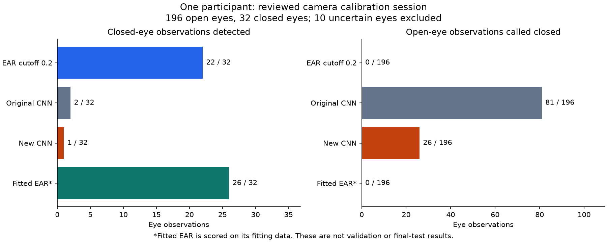

# First independently reviewed laptop camera diagnostic

Recorded 10 November 2026. This is a one-participant calibration diagnostic,
not independent validation, final-test performance or an event-level result.

Subsequent user decision: use public datasets instead of immediate teammate
recording. The [public-data continuation](RT_BENE_PUBLIC_DATA_EXPERIMENT_2026_11_10.md)
records a completed pretrained checkpoint diagnostic and a controlled public
training pilot. Collection recommendations below describe the earlier state.

## What changed

The user completed the local review of 119 sampled frames and exported 238
per-eye observations. The queue contains 196 open eyes, 32 closed eyes and
10 uncertain/unobservable eyes. All rows belong to the same confirmed participant,
reserved for calibration. The reviewer saw original frames without EAR/CNN
predictions or prompt-derived labels. Choices, revisions and source identity
are retained locally with the original queue.

The existing perception adapter prepared all 238 crops and geometry observations.
The 228 independently observable eyes were usable by both EAR and CNN, so the
direct comparison uses exactly the same observations. The ten uncertain labels
are retained in the data and excluded from binary metrics. Perception acceptance
does not override human uncertainty or establish correct geometry.

## Measured diagnostic

Positive class is closed. FP is an open eye called closed; FN is a missed
closed eye. Fixed raw thresholds are EAR below 0.2 and CNN at least 0.5.

| Method | TP / 32 closed | FN | FP / 196 open | Accuracy | Closed recall |
| :--- | ---: | ---: | ---: | ---: | ---: |
| EAR, existing cutoff 0.2 | 22 | 10 | 0 | 95.61% | 68.75% |
| Original MRL CNN | 2 | 30 | 81 | 51.32% | 6.25% |
| New ten-epoch MRL CNN | 1 | 31 | 26 | 75.00% | 3.13% |
| Fitted EAR, scored on its fitting data | 26 | 6 | 0 | 97.37% | 81.25% |
| Always predict open reference | 0 | 32 | 0 | 85.96% | 0% |



The new CNN's 93.19% MRL validation accuracy did not transfer to this RGB
recording. Its camera accuracy is lower than an always-open rule, and its
closed-eye recall is especially poor. Aggregate accuracy alone would obscure
this failure because open eyes dominate the reviewed sample.

The fitted EAR result is optimistic because these same eyes supplied its
coefficients. No independent participant has validated that mapping. None
of these numbers is a false-alerts-per-hour measure: these are sampled single
eyes, not fully annotated bilateral events.

## EAR fitting completed

The existing constrained fitter used the 228 reviewed, usable calibration eyes.
It converged in eight iterations with its existing regularization of 0.001.
The fitted mapping is:

```text
p_closed = sigmoid(-68.02365571160658 * EAR + 16.765849562697486)
```

The direction-boundary flag is false. This is a provisional, participant-specific
fit, not a frozen camera configuration. The runtime EAR threshold remains 0.2;
no live alert policy or fusion weight was changed.

## Why lowering the CNN cutoff is insufficient here

The new CNN's median closed-eye score was 0.004679, below the median open-eye
score of 0.064547. Its empirical ROC AUC on this calibration sample was 0.2377,
where larger scores are supposed to indicate closure. The original CNN's AUC
was 0.1609. These are local diagnostics on correlated frames from one person.

Selecting a new-CNN cutoff on these calibration eyes to catch at least 95% of
closed eyes gave approximately 0.0000111506. It detected 31 of 32 closures but
incorrectly called 190 of 196 open eyes closed, a 96.94% false-positive rate.
This is an inspected failure tradeoff, not an adopted rule. Positive temperature
scaling cannot repair the ordering of scores because it is monotonic.

Two failed closed-eye examples were inspected with their original full frames
and extracted crops, at approximately 18.297 and 37.453 seconds. The former is
a clear example where a closed eye receives a very low CNN closure score.
The shared training/runtime grayscale and resizing path and width-based crop
code were inspected. No specific implementation fault was established.
Infrared-to-RGB transfer, glasses/reflections and crop appearance are plausible
contributors, but this session does not isolate their causal effects. Do not
flip model labels merely to make this one session look better.

## Decision and next prerequisite

Keep the CNN out of selected live alerts and retain EAR as the existing
experimental alert source. Do not select a fusion weight from this calibration
session and call it validation. The implemented fusion path is still available
for a later correctly separated comparison.

Collect independently reviewed RGB recordings from other participants. Define
whole-participant roles before fitting: target-domain training data for any CNN
adaptation, calibration data for mappings, validation people for selection and
untouched test people for the final comparison. Do not move this participant's
calibration frames into training to manufacture a gain. Small team cohorts are
pilots; broad reliability requires more people and conditions.

## Local evidence and reproduction

The original session directory is data/raw/camera/local_user_001_2026_11_09_session_02/.
Human labels and revision history remain local; no face images are in Git.

* human_reviewed.csv: completed human annotation export.
* human_review_progress.json and human_review_actions.jsonl: source identity,
  reviewer, partition and recorded human choices.
* data/processed/camera_user_001_session_02_prepared.csv and adjacent metadata:
  prepared geometry/crop identity, quality settings and hashes.
* reports/local/camera_user_001_session_02_ear_calibration.json: fitted mapping,
  convergence, data audit and source hashes.
* reports/local/camera_user_001_session_02_diagnostic.json and .scores.csv:
  aggregate metrics and per-eye values, including retained uncertain rows.
* reports/local/camera_user_001_session_02_score_order.json: score-order and
  calibration-threshold diagnostic.

The compact [shared evidence JSON](evidence/camera_calibration_diagnostic_2026_11_10.json)
contains aggregate results and artifact hashes without face images or image paths.

Preparation and fitting commands used, with new output paths required on repeat:

```powershell
.\.venv-cognition\Scripts\python.exe scripts/prepare_dataset.py data/raw/camera/local_user_001_2026_11_09_session_02/human_reviewed.csv models/face_landmarker.task data/processed/camera_user_001_session_02_crops data/processed/camera_user_001_session_02_prepared.csv
.\.venv-cognition\Scripts\python.exe scripts/calibrate_scores.py data/processed/camera_user_001_session_02_prepared.csv reports/local/camera_user_001_session_02_ear_calibration.json
```

Diagnostic scoring used each unchanged checkpoint's CNN.logit on the prepared
OpenCV BGR crop and the shared sigmoid conversion. Raw EAR decisions used strict
EAR < 0.2; the fitted mapping used sigmoid(slope * EAR + intercept). Scores were
compared at 0.5 with the existing calibration.metrics function. Missing or
human-unobservable rows were excluded from binary metrics but retained in the
inventory. No weights or cutoff were fitted to a validation/test participant.
