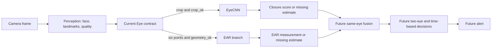

# CNN work completed to date

**Status checked:** 6 November 2026

**Project:** `driver-drowsiness-detection`

**CNN branch:** `cnn`

**Owner:** Arushi
**Implementation at the time this report was written:** through `7818a18`;
the later calibration analysis is recorded below.

This is a record of completed work and measured results, rather than a claim that
the whole cognition or driver drowsiness system is finished. The CNN predicts
eye closure from one eye crop. EAR, two-eye decisions, time-based drowsiness,
alerts and Jetson deployment require separate integration and validation.

## 1. Where the CNN fits



The shared `Eye` observation carries the frame ID, time, track, anatomical side,
points and crop. `CNN.estimate()` returns an `Estimate` with method `cnn`,
the same identity fields and a closure score only when the current crop is valid.
An invalid crop produces `value=None`; it does not reuse an old image or call
an invalid eye open. The eventual fusion layer must match identity and time
before combining CNN and EAR. A single closed eye is not a drowsiness diagnosis.

## 2. Git history and ownership

| Commit | Recorded change | Scope |
| --- | --- | --- |
| `730d436` | `CNN architecture files added` | First CNN model, inference, dataset, training and evaluation files. |
| `1ff853a` | `Integrate final perception contracts and capture pipeline into CNN development` | Brought the shared perception implementation into `cnn`. |
| `66a446e` | `Repair CNN perception integration and validate dataset and CPU training workflow` | Repaired interfaces, added audit, preparation adapter, documentation, CI and tests. |
| `48e7807` | `Enable laptop CUDA training and audit original CEW release` | Teammate's RTX 3050 smoke test and CEW inspection work; no real CNN training in that commit. |
| `8ac290e` | `Record laptop CPU training choice alongside teammate GPU option` | Recorded the choice to train on Arushi's Intel laptop. |
| `6970b3c` | `Prepare official MRL eye data and run laptop CNN pilot` | MRL importer, subject split, pilot training and measured pilot report. |
| `7818a18` | `Audit full MRL eye data and document laptop CNN validation` | Parallelized image audit and recorded full training/validation. |

The other laptop's RTX 3050 was verified for **synthetic CUDA execution**; see
[Laptop GPU training](LAPTOP_GPU_TRAINING.md). The real MRL training described
below ran on **Arushi's Intel CPU laptop**, not the RTX 3050 and not Jetson.
Vishruth owns the EAR work on `codex/ear-cognition`.

## 3. Code and folder linkage

```text
driver-drowsiness-detection/
|-- configs/runtime.yaml                 # perception settings for full-frame preparation
|-- data/manifests/eye_annotations.template.csv
|-- data/raw/mrl/                       # local MRL archive and extracted PNGs; ignored
|-- data/processed/                     # local manifests/crops; ignored
|-- environments/windows-training.txt  # Windows Python 3.11 CPU dependency set
|-- models/checkpoints/                 # local PyTorch weights; ignored
|-- reports/runs/                       # local evaluation JSON; ignored
|-- scripts/
|   |-- prepare_mrl_dataset.py          # official MRL archive -> subject-split manifest
|   |-- sample_mrl_pilot.py             # small reproducible pilot manifest
|   |-- audit_dataset.py                # validate manifest and image files
|   |-- prepare_dataset.py              # full frames -> perception eye crops
|   |-- train_cnn.py                    # fit EyeCNN and save best validation checkpoint
|   `-- evaluate.py                     # fixed 0.5 cutoff report by subject
|-- src/marvel/
|   |-- contracts.py                    # Frame, Eye and Estimate data contract
|   |-- cognition/
|   |   |-- cnn_architecture.py          # EyeCNN torch module
|   |   `-- cnn_inference.py             # checkpoint checks and runtime CNN estimate
|   `-- training/
|       |-- dataset.py                  # manifest rules and lazy image loader
|       |-- transforms.py               # shared training/inference image conversion
|       |-- audit.py                    # image decode/hash and split checks
|       `-- preparation.py              # offline perception adapter
`-- tests/                              # dataset, inference and pipeline checks
```

`scripts/` adds `src/` to Python's import path. For MRL, the source is already
an eye crop, so its manifest points `crop_path` to the original PNG. The
full-frame `prepare_dataset.py` path is available for future reviewed video
frames; it uses the perception detector and retains invalid rows, landmarks
and rejection reasons. We did **not** run NTHU preparation because NTHU data
and its annotation schema have not been obtained.

### Main class and function flow

1. `read_manifest()` validates columns, class labels, identity fields, paths,
   timestamps where available and subject/session/video partition ownership.
2. `audit_manifest()` opens and verifies each image, hashes its exact bytes,
   rejects identical images across splits and reports counts after filtering.
3. `EyeDataset.__getitem__()` loads one crop on demand and applies
   `array_from_image()`. It does not preload all images into RAM.
4. `array_from_image()` converts to grayscale, resizes to **64 by 32** with
   bilinear interpolation and scales `uint8` pixels to `[0, 1]`; the resulting
   array has shape `(1, 32, 64)`. `array_from_bgr()` makes live OpenCV crops
   follow the same conversion.
5. `EyeCNN` accepts batches shaped `(N, 1, 32, 64)`. Three convolution blocks
   with ReLU and pooling lead to a 64-feature vector and one **logit** per eye.
   Sigmoid converts that logit to a closed-eye score.
6. `train_cnn.py` uses Adam at learning rate `0.001`, batch size 32,
   `BCEWithLogitsLoss`, seed 7 and the lowest validation loss to select weights.
   The checkpoint stores class map, preprocessing, manifest hash, selected
   epoch, seed, subject lists and the dataset audit. A history JSON is saved.
7. `CNN` loads the checkpoint with `weights_only=True`, verifies class map and
   preprocessing, and returns an `Estimate` for a valid current `Eye`. It has
   a temperature argument, but **temperature has not been fitted**. The
   `OpenCVCNN` path exists for an ONNX artifact, but no Jetson export has been
   validated.
8. `evaluate.py` scores the chosen validation or test partition, reports
   TP/TN/FP/FN, accuracy, closed-eye precision/recall/F1 and each subject's
   results. Its **0.5 cutoff is an unvalidated baseline**, not a tuned rule.

Project class labels are `0=open`, `1=closed`; positive-class metrics count
closed eyes. This is the reverse of the inspected MRL archive's `0=closed`,
`1=open`, so the importer explicitly translates labels.

## 4. Environment and data decisions

- Arushi selected **laptop-only** training. Her measured machine is an Intel
  Core i5-1235U with 15.7 GiB RAM and Intel Iris Xe. Python 3.11 and
  PyTorch `2.14.1+cpu` were used; CUDA was unavailable here. `pip check`
  passed. The isolated environment is `.venv-cognition`.
- The proposal names **NTHU-DDD** as the main driving-video benchmark. Its
  recordings and annotations were **not downloaded**. Historical access
  instructions require a request/agreement; the current process still needs
  confirmation. We did not invent NTHU eye labels or train on it.
- The original **CEW** release was inspected for perception feasibility.
  It was **not used to train this CNN**, because eye labels and reliable
  identity grouping needed for a defensible split were unresolved. See
  [Dataset access and inspection](DATASET_ACCESS_AND_INSPECTION.md).
- For supplemental eye classification, the [MRL Eye Dataset authors' release](https://mrl.cs.vsb.cz/eyedataset.html)
  was downloaded to `data/raw/mrl/mrlEyes_2018_01.zip`. The local archive
  SHA256 is
  `17ff89928005cb6e63a53fe020e419060279ff59e57555cfa49693fc1865fdfc`.
  Its CRC, `annotation.txt` label legend, path layout, **84,898 PNGs** and
  **37 subject folders** were checked before extraction.
- MRL supplies eye-only infrared images and subject identifiers, but no
  reliable anatomical left/right side, frame timestamp, video or session
  identity. The manifest records `eye_side=unspecified` and a blank timestamp.
  Conservative grouping puts every image from a subject in one split; group
  names ending in `all_unknown_sessions`/`all_unknown_videos` do **not**
  claim knowledge of real recording boundaries.

### Full MRL subject split

| Split | Subjects | Eye images | Used for |
| --- | ---: | ---: | --- |
| Train | 25 | 54,617 | Fit network weights |
| Calibration | 4 | 10,317 | Reserved; no score calibration done yet |
| Validation | 4 | 16,263 | Choose epoch and inspect errors |
| Test | 4 | 3,701 | Held out; not scored |

Subject-level separation prevents one identified subject from appearing in
multiple partitions. The audit verified all **84,898** images decode and no
exact image-byte duplicate crosses partitions. Exact hashing cannot find
every near duplicate, annotation mistake or source-specific bias.

## 5. Actual runs and measured results

### Pilot (6 November 2026)

`sample_mrl_pilot.py` selected at most 50 images per subject and class from
train, calibration and validation, excluding test. The pilot manifest held
**3,023 eyes**: 2,284 train, 400 calibration and 339 validation. It passed
the image, class and split audit. One CPU epoch took **10.73 seconds**
including loading/audit; a fresh ten-epoch run took **38.76 seconds**.
The saved checkpoint came from epoch 8, the lowest validation loss, 0.68259.

| Validation eyes | TP | TN | FP | FN | Accuracy | Closed recall | Closed F1 |
| ---: | ---: | ---: | ---: | ---: | ---: | ---: | ---: |
| 339 | 140 | 47 | 92 | 60 | 0.5516 | 0.7000 | 0.6481 |

The pilot was an execution and early quality check, not a deployable model.
Full detail: [MRL laptop pilot](MRL_LAPTOP_PILOT.md).

### Full MRL training and validation (6 November 2026)

The full audit plus **three CPU epochs** took **713.29 seconds** using four
CPU threads. The loss history was:

| Epoch | Train loss | Validation loss |
| ---: | ---: | ---: |
| 1 | 0.5864 | 0.4481 |
| 2 | 0.4267 | 0.5462 |
| 3 | 0.3792 | **0.4002** |

Epoch 3 had the lowest validation loss and was saved to the local checkpoint
`models/checkpoints/mrl_full_3epoch.pt` (SHA256
`f33202048a72f14e0aeb2aa4d5dae622af036d56619c52e815dca534d8bb75bd`).
The audit was made faster with a bounded, eight-worker image verification
pool, then rechecked on the pilot and full data.

At the **uncalibrated 0.5 cutoff**, validation gave:

| Validation eyes | TP | TN | FP | FN | Accuracy | Closed precision | Closed recall | Closed F1 |
| ---: | ---: | ---: | ---: | ---: | ---: | ---: | ---: | ---: |
| 16,263 | 8,392 | 5,054 | 2,483 | 334 | 0.8268 | 0.7717 | 0.9617 | 0.8563 |

The **2,483 false positives are open eyes predicted closed**. Two validation
subjects had no correctly identified open eyes, although those subjects had
only 28 and 11 open examples. This makes an aggregate score insufficient for
alert design. The pilot and full scores use different-sized samples; they are
not a controlled architecture comparison. Full detail and local report path:
[Full MRL training](MRL_FULL_TRAINING.md).

The local code suite last passed **62 tests, with 1 skipped** after the full
audit change. Tests include synthetic training/evaluation and contract checks.
They do not prove webcam, Jetson or drowsiness accuracy.

## 6. Commands used and how to reproduce

Run from the repository root in **PowerShell**. The commands below describe
the workflow; existing output paths are protected against overwrite, so use
new versioned names for a rerun. Download the archive from the authors' page
separately and place it under `data/raw/mrl/` before import.

```powershell
git fetch origin
git switch cnn
git pull --ff-only origin cnn

py -3.11 -m venv .venv-cognition
.\.venv-cognition\Scripts\python.exe -m pip install -r environments/windows-training.txt
.\.venv-cognition\Scripts\python.exe -m pip check

.\.venv-cognition\Scripts\python.exe scripts/prepare_mrl_dataset.py data/raw/mrl/mrlEyes_2018_01.zip data/processed/mrl_manifest_v1.csv
.\.venv-cognition\Scripts\python.exe scripts/sample_mrl_pilot.py data/processed/mrl_manifest_v1.csv data/processed/mrl_pilot_v1.csv
.\.venv-cognition\Scripts\python.exe scripts/audit_dataset.py data/processed/mrl_pilot_v1.csv
.\.venv-cognition\Scripts\python.exe scripts/train_cnn.py data/processed/mrl_pilot_v1.csv models/checkpoints/mrl_pilot_10epoch.pt 10 cpu
.\.venv-cognition\Scripts\python.exe scripts/evaluate.py data/processed/mrl_pilot_v1.csv models/checkpoints/mrl_pilot_10epoch.pt validation reports/runs/mrl_pilot_validation_v2.json cpu

$env:OMP_NUM_THREADS = '4'
$env:MKL_NUM_THREADS = '4'
.\.venv-cognition\Scripts\python.exe scripts/train_cnn.py data/processed/mrl_manifest_v1.csv models/checkpoints/mrl_full_3epoch.pt 3 cpu
.\.venv-cognition\Scripts\python.exe scripts/evaluate.py data/processed/mrl_manifest_v1.csv models/checkpoints/mrl_full_3epoch.pt validation reports/runs/mrl_full_validation_v1.json cpu
```

If `.venv-cognition` already exists, reuse it rather than recreating it. On
this laptop, the archive, extracted PNGs, manifests, checkpoints and detailed
JSON results exist locally. All are intentionally excluded by `.gitignore`;
teammates pulling `cnn` receive **code and documentation, not those files**.
The tracked `.github/workflows/cnn.yml` checks the code independently of the
private/local dataset.

## 7. Calibration and false-positive review

After the full MRL run, we fitted a temperature on calibration subjects and
measured the resulting score and cutoff choices on validation subjects. The
fitted temperature was **1.7201**. Calibration NLL improved from **0.5250**
to **0.4859**, while validation NLL worsened from **0.4002** to **0.4093**.
It is therefore an experimental fit, not an adopted runtime setting.

A cutoff selected to keep the calibration open-eye FPR at or below 5% was
**0.7581** on temperature-scaled scores. On validation it reduced false
positives from **2,483 to 493**, but increased missed closed eyes from
**334 to 2,462**. Validation open-eye FPR was **6.54%**. Error rates varied
substantially by subject, glasses, reflection and sensor. Five high-score
false-positive images were inspected visually as a spot check; a local queue
holds all 493 for further review. No runtime cutoff has been frozen, and
the MRL test split remains unscored. See
[MRL calibration and validation](MRL_CALIBRATION_VALIDATION.md) for methods,
condition counts and limitations.

After Arushi prioritized avoiding missed closures, a provisional raw-score
cutoff chosen for at least 95% calibration recall reached **98.14% closed-eye
recall** on MRL validation, but called **52.61% of open eyes closed**. It was
not adopted as a live decision rule.

## 8. ONNX export and live path

The model was also exported to ONNX opset 11, checked against PyTorch on
100 validation eyes, and connected to the laptop perception preview. Two
short webcam runs produced live eye crops and scores and reopened cleanly.
This verifies laptop software linkage, not webcam eye-state accuracy.
See [CNN export and live probe](CNN_EXPORT_AND_LIVE_PROBE.md).

## 9. What remains before using CNN in the project

1. Review more false-positive images, especially under glasses/reflections,
   and investigate why the temperature fit worsened validation probability
   quality. Define the project's operating objective before choosing a
   deployable cutoff. The current 0.5 remains only a baseline.
2. Freeze model, preprocessing, calibration and decision rules **before** a
   final held-out test evaluation. The MRL test split has not been scored.
3. Obtain and inspect the proposal's NTHU-DDD data. Its driving videos and
   annotations are needed for paired-eye, EAR, blink/time and overall
   drowsiness studies. Do not equate a video drowsiness label with an eye label.
4. Collect or review representative webcam/Jetson eye crops with appropriate
   labels. MRL is infrared and eye-only; its validation score cannot establish
   RGB camera accuracy or live false-alert rate.
5. Integrate a validated CNN artifact with Vishruth's EAR branch through the
   shared `Eye`/`Estimate` contract, keeping invalid evidence missing. Test
   same-frame identities, bilateral decisions and temporal logic separately.
6. Inspect Jetson software compatibility, export if needed, check numeric
   parity, latency, FPS and memory on the actual board. No CNN Jetson camera
   result has been recorded yet.

**Current conclusion:** the branch has a functioning training and inference
pipeline, one audited subject-separated MRL eye-classification experiment,
and a calibration/error-analysis experiment. It does **not** yet have
validated live eye classification, drowsiness detection or Jetson deployment.
