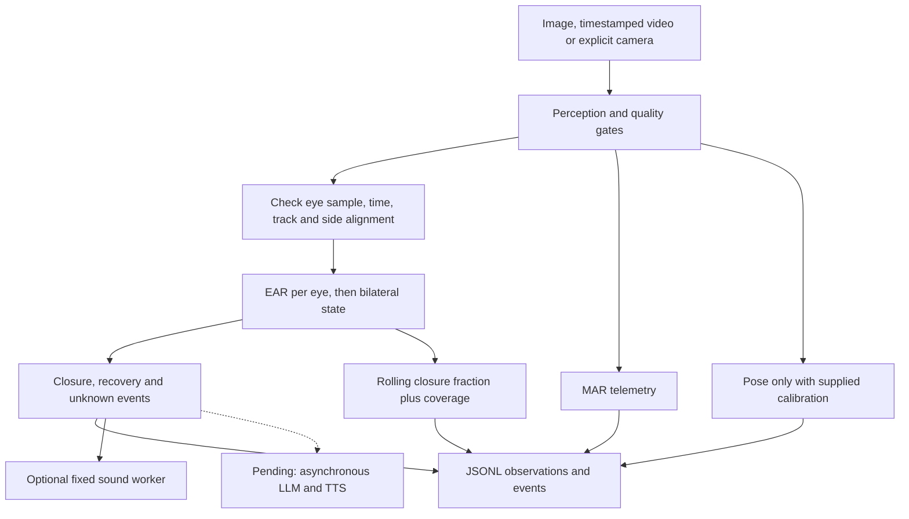

# Integrated cognition runtime

Current entry point documentation is in [LAPTOP_CAMERA_GUIDE.md](LAPTOP_CAMERA_GUIDE.md).
The 9 November update adds optional CNN/comparison adapters, speech and timing
reports. The EAR camera and audible fixed speech were checked interactively.
The October implementation notes below retain their original evidence scope.

Implementation update: 23 October 2026. Experimental thresholds are not validated fatigue boundaries.

## What runs now

The application connects perception, raw EAR classification, bilateral state, temporal events, a rolling closure proxy, MAR telemetry, optional calibrated head pose and optional Windows fixed audio. Images and recorded video have been exercised using the real landmark model. The camera adapter has mocked timing/lifecycle tests; no live camera was opened during this increment.

Reviewed EAR source and its focused tests were imported from `origin/ear-cognition` at `f8cddad`. This was a source integration into the current checkout, not a Git branch merge. Existing perception APIs remain compatible: `Detector.process` still returns `(eyes, status, metrics)`, and named mouth/pose geometry is added inside metrics.



## Run commands

Run these commands from the repository root. Replace example media paths with files you have. Choose a fresh log name for every run; existing logs are deliberately not overwritten. The explicit 0.2 EAR cutoff and default temporal settings are demonstration settings only.

```powershell
# Inspect one real face. A single image cannot prove sustained closure.
.\.venv-cognition\Scripts\python.exe scripts/run_cognition.py --image path/to/face.jpg --ear-threshold 0.2 --output reports/local/image-check.jsonl

# Recorded video must supply finite, increasing media timestamps.
.\.venv-cognition\Scripts\python.exe scripts/run_cognition.py --video path/to/recording.mp4 --ear-threshold 0.2 --output reports/local/video-check.jsonl

# Intentional live camera demonstration; q or Escape closes the display.
.\.venv-cognition\Scripts\python.exe scripts/run_cognition.py --camera --display --audio --max-frames 900 --ear-threshold 0.2 --output reports/local/camera-check.jsonl
```

The camera/model/ROI/quality configuration comes from `configs/runtime.yaml`, or an explicit `--config` path. All settings are recorded in the log, along with the landmark asset hash. Generated media must use `--synthetic-source`. The runtime opens no camera unless `--camera` is supplied and emits no sound unless `--audio` is supplied.

Timing options are `--close-seconds`, `--recover-seconds`, `--max-gap-seconds`, `--unavailable-seconds`, `--window-seconds` and `--min-coverage`. Defaults are 1.5, 0.5, 0.25, 2.0, 60.0 and 0.8 respectively. They are example policy values, not fitted settings. Image input uses time zero; video uses `CAP_PROP_POS_MSEC`; live input uses monotonic read-completion times. Video processing time is never substituted for media time.

## What the code does and why

### Alignment and EAR

`EARCognition.update` first requires exactly two observations with anatomical left/right sides, matching sample ID and timestamp, and one explicit track. Mixed observations become unknown before measurement. Each accepted eye is measured by the reviewed `measure` function, which respects `geometry_ok`. The two thresholded eye states pass through the shared bilateral rule: disagreement or invalid evidence produces `UNKNOWN`.

The current detector intentionally retains its existing shared crop-quality gate for EAR geometry. It has not been relaxed to increase coverage. Raw EAR values, validity and reasons are saved for inspection. Missing evidence remains null rather than zero. A real closed eye can legitimately have EAR zero.

The adapter passes the bilateral result to independent temporal and rolling-window objects. It uses the existing controller's event identifiers. Future CNN/fusion modes need their own instances so their histories cannot contaminate the EAR result.

### Rolling closure fraction and coverage

The rolling window stores observed intervals in a deque. It only credits an interval when both endpoints have the same valid eye state and their separation is at most the permitted gap. It excludes transition intervals because the exact transition time is unknown, and excludes intervals touching an unknown observation. A new explicit target clears the old window. Missing target information does not fabricate a target switch.

For a requested window length W:

* `valid_seconds` is the duration of accepted open or closed intervals inside that window.
* `closed_seconds` is the accepted closed duration.
* `coverage = valid_seconds / W`.
* `closure_fraction = closed_seconds / valid_seconds`, published only after a full window has elapsed and coverage meets the configured minimum.

Example: in a two-second window, accepted intervals total 1.5 seconds, of which one second is closed. Coverage is 75 percent and the closure fraction is about 66.7 percent. The excluded half-second is not treated as open.

Old intervals are removed and a boundary-crossing interval is clipped to the window start. Update work is O(K), where K is stored accepted intervals; storage is proportional to sampling rate times window duration. Correct time accounting comes before optimizing the sum.

This is explicitly `binary_closure_fraction_proxy`. It includes whatever the configured binary classifier calls closed and does not establish physical 80 percent eyelid closure or a clinical fatigue state. A PERCLOS claim still requires a declared physical closure criterion, blink policy, annotated sequence reference and error measurement.

### Mouth measurement

Perception exports MediaPipe indices `(78, 81, 311, 308, 402, 178)` in the six-point ordering used by the ratio function. Corners are entries 0 and 3; vertical pairs are 1/5 and 2/4. The measurement is the average vertical gap divided by horizontal width. The adapter checks geometry identity before reading it. It is logged as MAR and explicitly not treated as a yawn label. Geometric validity alone does not establish reliable mouth-event classification.

### Pose measurement

`HeadPose` requires measured intrinsics and a declared nonplanar six-point 3D face template corresponding to `(1, 152, 33, 263, 61, 291)`. It validates configuration before camera use, then rejects invalid image points, resolution mismatch, points behind the camera and excessive reprojection error. It uses OpenCV's iterative PnP solver, projects the solution back into the image to check error, and reports rotation angles relative to the declared template axes.

Supply a JSON file through `--pose-calibration`. Required fields are:

| Field | Meaning |
| :--- | :--- |
| `image_size` | Actual calibration resolution as `[width, height]` |
| `camera_matrix` | Measured 3 by 3 intrinsic matrix with positive focal lengths |
| `distortion` | Finite OpenCV distortion coefficients |
| `landmark_indices` | Exact six-index ordering above |
| `object_points` | Six corresponding nonplanar 3D template points |
| `template_axes` | Explicit description of template axis directions and neutral orientation |
| `max_reprojection_px` | Positive error threshold selected for the intended setup |

No example numbers are presented as real camera calibration. Obtain intrinsics from a camera calibration procedure at the intended capture resolution, document the template and verify pitch/yaw/roll against controlled movements. Arbitrary angles must not become fatigue labels. Current tests recover known synthetic rotations; they do not establish head-pose accuracy on the laptop camera.

The method and camera-coordinate assumptions follow [OpenCV's PnP documentation](https://docs.opencv.org/4.x/d5/d1f/calib3d_solvePnP.html). The solver maps declared object points into camera coordinates; a different template orientation changes the interpretation of the reported angles.

### Live timing and fixed audio

Live capture keeps a small queue and checks frame freshness. When capture produces no frame beyond the age limit, the runtime supplies unknown heartbeat observations. A frame captured before the latest heartbeat is discarded rather than fed to a controller whose clock has already advanced. Capture timeout is a visible error. Recorded media is exempt from wall-clock age checks because its timestamps belong to a different clock.

`FixedAlert.submit` accepts only prolonged-closure events, refuses immediate duplicate event IDs and drops new requests while the previous playback/result is outstanding. There is no playback backlog. A one-worker executor performs the Windows 400 ms tone while capture continues. `poll` exposes completion or failure; completion means the playback call returned, not that a person heard the speaker. The worker waits for the bounded built-in call only during shutdown. The Jetson/Linux sound backend and TTS are still pending.

The logger is synchronous and must be profiled under live load. The frame clock and computation latency should remain distinct when evaluating delay. A run ending with an active episode records it as unresolved, not recovered.

## Evidence from this increment

The final full suite passed 146 tests in 34.52 seconds with the real landmark asset and GPU checks available. A mocked camera test verifies missing-frame heartbeat notification, rejection of a late queued frame and resource cleanup. The focused pose tests use synthetic camera/template inputs. Audio tests inject a fake player and verify nonblocking submission, no backlog and visible playback errors.

The actual application processed an original CEW saved face and logged EAR values about 0.073 and 0.055, MAR about 0.0067, `CLOSURE_PENDING` and no event. This confirms the modules connect for that observation; it does not establish accuracy. Pose correctly reported `camera_calibration_missing`; the rolling metric remained unavailable because one image supplies no observed duration.

Remaining acceptance work: live camera/overlay/shutdown and audible check; real camera calibration; independent sequence evaluation and PERCLOS definition; suitable CNN data and fitting; calibration/fusion; local LLM/TTS choice and execution; Jetson compatibility and sustained performance.

Interview explanation: We align eye observations before classification, preserve invalid evidence, and separate frame-level geometry from temporal events. A time-weighted closure window reports both the statistic and its observation coverage. Pose is conditional on explicit calibration, and the fixed alert worker does not block capture.

Retention check: why is 100 percent closure over only 10 percent observable time insufficient evidence for a confident full-window conclusion?
