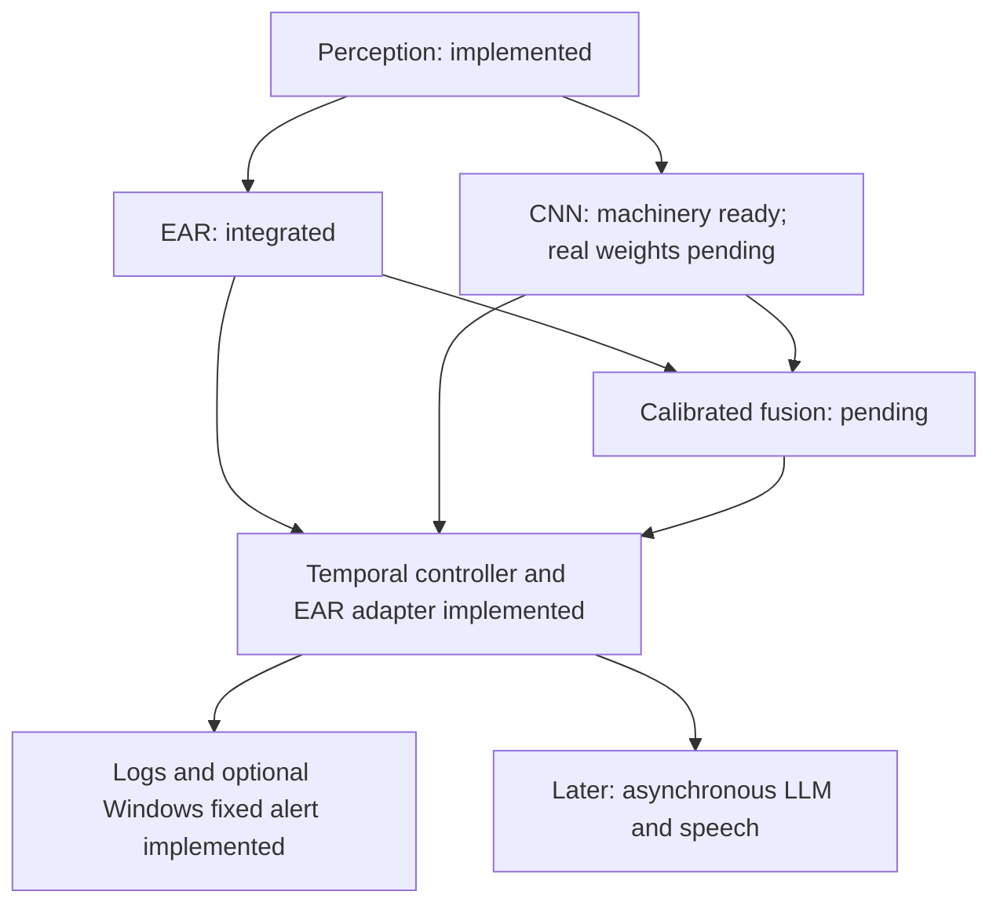

# Cognition status and next steps

## 10 November 2026: first camera recording and review tools

A confirmed participant completed a manually started recording with the preview
window verified on the desktop. The second session saved 1,739 full frames over
59.985 seconds, with a 0.078-second maximum saved-frame gap. All images decoded.
The first attempt is explicitly marked unguided because the user did not see its
prompts. The recorder now waits for Space before saving images.

A local human-review window is available for the 119 sampled frames (238 eyes),
with resume support and export checks. This participant is reserved for
calibration. Human review, class-balance checks, perception preparation and
separate validation/test participants are still needed before an accuracy claim.
See [the recording work record](WORK_RECORD_2026_11_10.md) and
[the collection/review commands](CAMERA_EVALUATION_COLLECTION.md).

## 9 November 2026: completed local CNN continuation

Arushi's checkpoint is now transferred and hash verified. The official MRL
archive reproduced the exact training-manifest hash. A fresh ten-epoch CUDA
run selected epoch ten. At the same raw 0.5 cutoff, MRL validation accuracy
rose from 82.67% to 93.19%; false positives fell from 2,484 to 752, while missed
closures rose from 334 to 355. One subject's recall worsened substantially, so
the aggregate gain does not establish reliable participant generalization.

The new checkpoint and ONNX export are local. A 100-eye ONNX parity check
passed, and the saved-face application path ran successfully. That face still
produced disagreeing CNN eyes while EAR returned CLOSED. No RGB camera or
fusion accuracy improvement has been established, and MRL test subjects remain
unscored. See the [experiment and evidence](MRL_LOCAL_CONTINUATION_2026_11_09.md).

Next: obtain and independently review full-frame RGB camera recordings using
the [collection protocol](CAMERA_EVALUATION_COLLECTION.md), fit EAR mapping,
and compare EAR/CNN/fusion with coverage and subject breakdowns. Laptop work
remains the priority; Nano deployment is still pending cooling and board tests.
The dated sections below describe earlier checkpoints and their then-missing
artifacts, rather than the current handoff status.

## 9 November 2026 update

Laptop camera integration now supports optional CNN artifacts, explicit fusion
settings, selected-mode alerts, fixed speech and a background local LLM path.
The user confirmed the live EAR warnings matched their closures and that tone
and speech were audible. A 90 second run processed 2,656 frames with eight
closure events and eight recoveries. The trained CNN artifact is still absent
after local and GitHub checks; no CNN camera accuracy is claimed. The separate
LLM worker check completed but used fixed fallback wording. See
[laptop guide](LAPTOP_CAMERA_GUIDE.md) and [work record](WORK_RECORD_2026_11_09.md).
The older audits below describe historical checkpoints.

The subsequent calibration increment implements the EAR fitter and fusion
validation analysis scripts. They require reviewed development manifests and
the trained CNN checkpoint for actual tuning. Their synthetic and regression
checks passed; no real-data fusion improvement is claimed. See
[calibration workflow](FUSION_CALIBRATION_WORKFLOW.md).

## 7 November 2026 update

The October audit below is historical. CNN work through `14ae038` was merged
locally in `feb609c`; its reports record MRL training, calibration experiments,
ONNX export and a short camera score check on Arushi's laptop. The trained
artifacts remain absent from this checkout. Fusion is now implemented as an
experimental aligned-score function with a separate three-mode estimate replay
adapter. Camera application wiring, fitted EAR mapping, validated fusion
parameters and real sequence evaluation remain pending. See
[comparison foundation](COMPARISON_FOUNDATION.md) and the
[dated work record](WORK_RECORD_2026_11_07.md) for current evidence.

Audit date: 22 October 2026. This is an implementation audit and proposed execution order, not a record of completed integration.

## Confirmed review scope and implementation update

The user selected the **full proposal, including PERCLOS, head pose and LLM voice**, and requested completion **this week**. These features are required for that review, even where the older Phase 1 plan deferred them. No exact review day or Jetson access slot has been confirmed. This is a target, not a claim that data access, accuracy validation or target deployment will finish on schedule.

The first implementation replaced the temporal-controller and basic JSONL-logger placeholders and added synthetic replay, passing 101 repository tests. The 23 October integration now connects the reviewed EAR component, MAR telemetry, rolling closure proxy, calibrated PnP interface and optional Windows fixed audio to an image/video/camera application. The final full suite passed 146 tests in 34.52 seconds, including the mocked camera-stall/late-frame check. Real-model image/video execution and a CEW saved-face smoke run passed. Camera preview, audible playback, real-camera pose calibration and LLM/TTS remain unverified or pending. See `COGNITION_RUNTIME.md` and `TEMPORAL_CONTROLLER.md`.

### Full-review delivery order

1. Temporal events, logs and deterministic replay. Core and EAR application wiring are implemented; perform the live demonstration next.
2. Live EAR and MAR, rolling time-weighted closure statistics with coverage, plus a fixed alert path. Declare whether the closure metric meets a validated PERCLOS protocol or remains a proxy.
3. Pose estimation and visible pitch/yaw/roll with quality status. Do not equate an arbitrary head angle with fatigue.
4. A stable event-to-telemetry interface, asynchronous LLM generation and actual audible TTS. Test the worker failure/timeout path and show that the immediate alert is unaffected.
5. In parallel with the preceding engineering, resolve data, train and evaluate the CNN, fit calibration, and compare EAR/CNN/fusion. Synthetic results cannot substitute for this evidence.
6. Run a Jetson environment and resource feasibility check as soon as the board is available, rather than waiting for all laptop features. Verify the selected model's export/runtime compatibility and benchmark the integrated system on the board.
7. Rehearse the complete review with recorded inputs, live demonstration where available, plots/logs and an explicit list of verified results and unresolved limitations.

The software demonstration and scientific validation are separate acceptance gates. A fallback template is not proof of working LLM generation; laptop inference is not proof of on-device Jetson inference; a rolling binary closure fraction is not automatically validated P80 PERCLOS.

## Verdict

The project now has an integrated EAR cognition application with event logs, MAR telemetry and a rolling closure proxy. The reviewed EAR source has been brought into the current checkout from its branch. Calibrated pose and fixed Windows sound have implemented interfaces and tests. This is still an experimental prototype: CNN/fusion validation, real-camera calibration, LLM/TTS, live hardware checks and Jetson deployment remain.

Dataset access blocks defensible model fitting and evaluation. It does not block implementation of the temporal controller, event contracts, logging, deterministic replay or an EAR demonstration with explicitly experimental thresholds.

## Sources and revisions checked

| Source | Evidence and role |
| :--- | :--- |
| Original `MARVEL_Proposal_Drowsiness_LLM-proposal.docx.pdf` in Downloads | All seven pages extracted; page 4 architecture visually inspected. Defines the full project: geometry, temporal state, Jetson, LLM, speech and quantitative evaluation. |
| `MARVEL_Drowsiness_LLM_Guide.md` in Downloads | Reviewed relevant geometry, PERCLOS, CNN, temporal, architecture and roadmap sections. Teaching reference, not tested runtime code. |
| `docs/PHASE_1_SYSTEM_DESIGN.md` | Later Phase 1 scope, three experimental modes, interfaces, timing, data separation and acceptance gates. |
| `docs/decisions.md` and Phase 1 team guides | Accepted work ownership and handoff boundaries. |
| `docs/full_pipeline/` | Local, untracked reference guides and companion code. Useful implementation material; its presence does not implement the root application. Reviewed architecture, calibration/fusion, temporal logic and execution/acceptance material. |
| `cnn` at `48e7807` | Current checkout. Includes perception integration, CNN development, GPU setup and CEW inspection. |
| `origin/ear-cognition` at `f8cddad` | EAR implementation and inspection CLI. Audited using an isolated archive without switching or merging branches. |
| `origin/final-perception` at `63ddcc1` | Integrated perception preview and handoff. |
| `origin/main` at `0dadd58` | Older scaffold baseline. Do not demonstrate current feature work from this branch. |

Historical proposals and performance targets are not evidence of measured accuracy, latency or board compatibility. This audit does not independently validate their literature, regulatory or market claims.

## What exists and what is left

| Component | Verified implementation status | Remaining work | Can engineering start now? |
| :--- | :--- | :--- | :--- |
| Camera, landmarks, eye crops, quality and timestamps | Wired into cognition; image/video tested and camera adapter tested with mocks | Live preview, camera freshness and shutdown check on hardware | Ready for hardware check |
| EAR geometry and per-eye decision | Reviewed `ear-cognition` source integrated locally with its tests | Validate threshold across people and conditions | Runtime implemented |
| Bilateral eye state | Adapter enforces matching sample, time, track and anatomical sides | Evaluate observation coverage and disagreement rates | Runtime implemented |
| MAR | Named mouth points, geometric ratio and logging implemented | Validate measurement quality; no yawn claim from MAR alone | Telemetry implemented |
| Eye CNN | Architecture, preprocessing, data validation, training, inference and checkpoint checks exist | Obtain suitable reviewed data, split correctly, train, select checkpoint and evaluate | Code ready; real data workflow unresolved |
| EAR probability mapping | EAR branch can apply supplied coefficients | Fit decreasing mapping on held-out calibration data and record provenance | Fitter and synthetic tests now; trustworthy coefficients later |
| CNN calibration | Inference accepts a positive temperature | Measure calibration; fit temperature if justified, using calibration partition | Same separation as EAR |
| Fusion | Root `fusion.py` is a placeholder; reference example exists | Alignment checks, calibrated inputs, missing-branch policy, validation-selected weight/threshold, frozen bundle | Logic now; learned settings need data |
| Closure duration and recovery | Implemented and connected to EAR | Validate selected timings on labelled sequences | Core and adapter implemented |
| Integrated application | `main.py` now runs the image/video/camera EAR application | Live demonstration and remaining CNN/fusion/voice paths | EAR path runnable |
| Event logging and immediate sound | Provenance logs and optional bounded Windows sound worker implemented | Audible hardware check, target audio adapter and voice integration | Worker tests pass |
| Rolling closure statistic | Time-weighted proxy, valid-time coverage, warm-up and gap treatment implemented | Validate physical closure criterion before claiming P80 PERCLOS | Proxy implemented |
| Richer fatigue states | Reference policy examples only | Labelled sequence protocol, justified transitions and evaluation | Mechanism now; validated meaning needs evidence |
| Head pose | Calibrated six-point PnP, rejection checks and synthetic-projection tests implemented | Supply measured camera intrinsics and declared 3D template, then verify real head movements | No fabricated camera parameters |
| Evaluation | CNN evaluation machinery exists | Shared three-mode replay, calibration metrics, coverage, event recall, false alerts per hour and detection delay | Evaluation plumbing now; results require suitable test data |
| Jetson export and profiling | ONNX inference adapter exists; profiling/export pipeline not completed in root scripts | Export/parity checks, target environment inventory, sustained latency/memory/thermal measurement | Prepare on laptop; target claims require board testing |
| LLM and speech | Full-project scope, not implemented by cognition | Event-to-telemetry interface, asynchronous worker, timeout/fallback, actual target benchmark | Interface later; model integration after working alerts |

## How the pieces connect

EAR and CNN answer a per-eye question at one observation. Fusion combines aligned evidence. The temporal controller asks whether observed closure persists long enough, whether monitoring is unavailable, and whether reopening is sufficient to recover. An event is the structured output consumed by logging and actuation.

Use the same controller algorithm and temporal settings in the first comparison, but three independent histories. Never put alternating EAR, CNN and fusion outputs into a single tracker.

## Proposal corrections and scope reconciliation

1. **Full proposal and Phase 1 differ.** The original proposal includes MAR, pose, PERCLOS, richer states, Jetson optimization and LLM speech. The later design makes EAR/CNN/fusion comparison mandatory in Phase 1, keeps MAR as telemetry, and defers full PERCLOS, pose interpretation and LLM speech. Deferral is not removal from the overall project.
2. **The training commitment changed.** The proposal says the team will integrate pretrained tools without building models from scratch. The current small eye CNN is custom and requires training. Record this as a scope revision. The MobileNet suggestion in the design is a candidate to investigate, not a requirement to replace the existing model before obtaining a baseline.
3. **Do not copy the old frame-count PERCLOS example into runtime.** It assumes fixed FPS, uses an EAR threshold as a closure proxy, and does not establish physical 80 percent eyelid closure. A declared time-weighted closure fraction with coverage is a useful intermediate result. Calling it validated P80 PERCLOS requires an independently labelled closure protocol, including blink and missing-data treatment.
4. **Use observable operational labels first.** `OPEN`, `CLOSURE_PENDING`, `ALARM` and `UNKNOWN` describe system evidence. Eyes open does not establish alertness; a closed-eye image does not establish microsleep. Mapping to the proposal's fatigue categories requires suitable sequence labels and evaluation.
5. **Keep the first alert independent of LLM latency.** A confirmed event should enqueue immediate fixed audio and separately enqueue optional text generation. The LLM must not decide whether the event occurred or delay it. A GPIO buzzer alone does not establish the proposal's claimed independence from software failure; that would need a separately specified and tested mechanism.
6. **Personal calibration needs a protocol.** Do not silently treat the first 30 seconds as confirmed normal eye opening. A later guided baseline needs quality checks, explicit completion/failure, frozen parameters and no adaptation during suspected closure.
7. **Fusion improvement is a hypothesis.** Both branches share a face detector and crop geometry, so their errors can be correlated. Preserve EAR-only and CNN-only baselines and report if fusion does not improve the selected objective.
8. **Quality gates need an explicit decision.** Current `detection.py` sets `geometry_ok=geometry and valid`, where `valid` comes from crop-quality checks. EAR therefore inherits crop rejection. Initially document and measure this shared gate. Before claiming independent robustness, review whether geometry validity and CNN image validity should diverge; removing a gate without validation is not a fix.
9. **Targets remain targets.** The proposal's FPS, accuracy and LLM latency numbers are not measured results. Laptop CUDA availability does not establish Jetson Nano package support, runtime memory headroom or inference speed.

## Implement in this order

### Increment 1: EAR temporal replay and event contract

Integrate EAR and CNN branch work in a reviewed integration branch. Preserve shared contracts and existing tests; do not replace working modules with entire reference files.

Implement `trigger.py`, typed event records, a deterministic replay entry point and structured logs. Start with synthetic observations and label their provenance explicitly. Use monotonic time for live observations and media time for recordings. Keep wall-clock time separate.

Acceptance scenarios:

1. A short closure that reopens before the configured duration produces no prolonged-closure event.
2. Sustained valid closure produces one event at the first observed timestamp reaching the duration.
3. Continued closure does not emit a new event every frame.
4. Explicit unknown observations and excessive gaps break candidate continuity; missing time is never added as closure or reopening.
5. Unknown after an alarm does not claim recovery. The current observation can be unknown while an alarm remains outstanding.
6. Valid reopening must persist for the configured recovery duration before resolving an event.
7. Target changes prevent evidence from different tracking epochs being combined. Preserve the previous event's unresolved disposition in the log.
8. Persistent unavailability produces a separate bounded notification, never a fabricated closed-eye state.
9. Nonfinite or nonincreasing timestamps and invalid timing parameters are rejected explicitly.
10. Replaying identical observations at a different wall-clock speed gives identical event timestamps. Keep controller instances independent across modes.

Demo thresholds are configurable experimental values. Passing these tests proves controller behavior, not fatigue-detection accuracy.

### Increment 2: Live EAR, MAR telemetry and immediate alert

Connect the perception path to the same controller. Show each eye's raw EAR, current state, rejection reason, candidate duration and outstanding-event status. Add the documented MAR measurement without making it an alarm trigger. Wire bounded sound through a worker so playback cannot block capture or detection. Check shutdown and error handling.

Replay tests can run now. A live camera/audio demonstration requires an intentional user session; use a stationary setup. Completion means an end-to-end observable prototype with logs, not a validated detector.

### Increment 3: Data and CNN fitting

The original CEW download currently contains 2,423 normalized faces. The existing probe produced 4,749 accepted eye crops out of 4,846 possible eyes. This is preprocessing acceptance, not classification accuracy.

The inspection report explicitly blocks training readiness because closed-face person identities, cross-class identity overlap, reviewed per-eye labels and subject-disjoint partition assignments remain unresolved. A filename/source-image group is not automatically a person identity.

Keep CEW as inspection/review material until those limitations are addressed. A dataset with documented subject grouping can support honest splits; sequence data is additionally needed for event evaluation. Follow original-source access and usage terms. NTHU access and MRL download were unresolved in the preceding setup work; neither is present as a usable training dataset here.

The desired development flow is: audit provenance and labels, group/split by subject and recording, generate crops, fit weights on training data, fit score mappings on calibration data, choose settings on validation data, freeze everything, then evaluate once on the held-out test set. Check duplicate/cross-source leakage as well as split names.

### Increment 4: Calibration, fusion and three-mode comparison

Implement calibration fitters and strict fusion now using known synthetic cases for correctness. Fit real settings only after data is usable. EAR uses a decreasing mapping; CNN calibration is checked rather than assumed. Select fusion weight and decision thresholds using validation data with a declared objective. Test endpoint weights, but preserve standalone modes with their own validity coverage.

Run all three modes on the same source observations with separate temporal histories. Report performance on their common observable subset and coverage for each full mode. A method rejecting difficult frames must not appear better solely because rejected observations vanished from evaluation.

Freeze checkpoint, preprocessing, landmark asset, mappings, quality gates, thresholds and temporal configuration with identities/hashes. Current checkpoint checks are useful but do not yet freeze the entire runtime decision process.

### Increment 5: Full-proposal temporal features and deployment

Add the time-weighted rolling closure proxy and valid-time coverage. Add pose and richer states only with declared quality and label protocols. Evaluate against independently annotated sequences, including false alerts during negative time, event recall, duplicates, unscorable intervals and event delay.

Export the selected CNN, verify output parity, and benchmark the actual Jetson configuration. Measure capture-to-decision age, sustained throughput, memory, temperature and backlog. Model training normally remains on the laptop; moving the same model to Jetson requires conversion and inference verification, not retraining solely because the device changed.

Then connect an asynchronous LLM/TTS worker to the stable event interface and test failure, timeout and stale-event handling. Confirm whether the target supports the selected model before promising on-device execution; retain the proposal's paired-device fallback as a choice if needed.

## Ownership preserved

The recorded split remains: Vishruth owns geometry, fusion and temporal logic; Arushuuu owns dataset work, CNN and evaluation, with mutual review. Shamaa owns capture and overlays; Niharika owns logging, audio and profiling. Work can proceed concurrently through agreed observation/event interfaces without waiting for trained weights.

## Checks and limits of this audit

The prior setup run on the current CNN revision passed 62 tests, including GPU/checkpoint checks. During this audit, the isolated EAR branch's focused suite passed 15 tests with the real landmark asset available. Pytest reported a cache-directory permission warning; test execution passed. These are implementation checks, not dataset accuracy results.

No full cognition merge, new training run, calibration fit, fusion accuracy result, labelled event benchmark or Jetson deployment was performed. The subsequent temporal implementation has synthetic behavioral tests and replay, as described above. No camera was opened and no sound was played. Reference examples were inspected, not accepted wholesale as production implementation.

The next demonstration deliverable is **a live camera session exercising the implemented EAR path, event logs and fixed sound**. Remaining development includes voice, calibration/fusion and sequence evaluation; real pose measurements need a calibrated camera. Follow the full-review order above while data acquisition proceeds.
