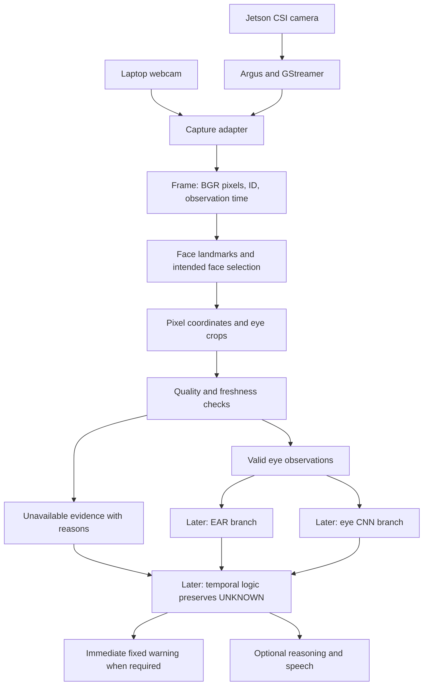
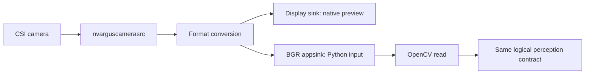
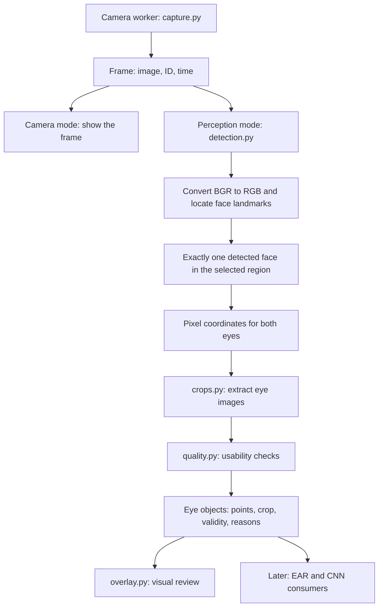

# MARVEL perception layer: discussion, implementation and Jetson reference

Prepared from this chat on 11 October 2026. This document consolidates the agreed scope, folder decisions, junior assignments, runnable code listings, learning explanations, acceptance checks and Jetson handoff. It is a reference specification and writing guide, not evidence that the application has already been implemented or tested on the team laptops.

## Part A. Decisions and reference plan

### A1. What we want to achieve

Build the input and perception path so the team can see live camera frames, locate a face and both eyes, display useful eye crops, and supply timestamped observations to later EAR and CNN modules. Develop and review this on Windows laptops, then connect the same logical pipeline to the Jetson Nano's camera input.

The dates discussed were Sunday, 11 October 2026 for the laptop demonstration and Monday, 12 October 2026 for the Jetson session. These are the original planned milestones. Update the team's actual status using the acceptance checklist rather than treating a date as proof of completion.

| Milestone | What it proves |
| --- | --- |
| Laptop camera preview | Python can acquire and display live webcam frames |
| Laptop perception demo | Face selection, eye points, crops, validity and structured output work in a controlled scene |
| Jetson native preview | Camera, driver and native display path work |
| Jetson Python preview | Camera frames reach Python/OpenCV through the selected capture backend |
| Jetson perception demo | The landmark runtime and complete perception path work on the actual board |

Seeing yourself in a camera window proves capture and display. It does not by itself prove landmark detection, usable crops, drowsiness detection or full Jetson deployment.

### A2. How this fits the system design

The repository system design and newer full pipeline architecture were inspected for this consolidation. The newer architecture guide records that the original proposal was reviewed in the earlier work. The original proposal document itself was not reopened for this consolidation; the mapping below follows those repository documents and this chat's decisions.

| Layer | Responsibility | Example output |
| --- | --- | --- |
| Perception | Acquire frames, select the intended face, locate facial points, crop eyes and assess usability | Frame and Eye objects with timestamps and validity |
| Cognition | Compute EAR/MAR, classify eyes, calibrate and combine evidence, interpret time | Eye states, closure events and operational state |
| Reasoning | Describe an already established event through the later language component | A checked short explanation |
| Actuation | Produce the immediate fixed warning and optional speech | Audible output and execution status |

Observability, training and evaluation support those layers. Immediate warning must not wait for language generation.



The camera supplies frames to the program. On Jetson, GStreamer is the acquisition and conversion path into Python. Changing capture backend is only one part of porting: interpreter, OpenCV and landmark runtime compatibility must also be checked.

### A3. Scope of the scripts in this document

Included: live camera capture, timestamps, bounded frame queue, camera preview, one detected face selection, eye landmarks, eye crops, simple quality checks, visible status, missing input handling and cleanup.

Not included: a trained eye CNN, EAR classification, calibrated fusion, temporal drowsiness decisions, alerts, LLM/TTS, a recording or replay adapter, persistent logging, automatic camera reconnection or a validated Jetson landmark installation.

The broader architecture also includes mouth and head pose inputs for later geometry work. The supplied teaching detector extracts the two eye point sets only. Exporting mouth and pose landmarks through an agreed contract is an additional task before claiming that every facial geometry input in the broader proposal is complete. It does not require postponing the camera and eye demonstration.

In this discussion, “recognizing” meant locating the face and eyes. Identifying a person by name is not required. The track label is a continuity heuristic, not biometric recognition.

### A4. Correct project and file status

Open this folder in Antigravity:

`C:\Users\alwan\Documents\driver-drowsiness-detection`

The older Desktop folder `C:\Users\alwan\OneDrive\Desktop\marvel-drowsiness-detection` is not the development checkout selected in this chat. The Documents checkout was verified against origin `https://github.com/driver-drowsiness-detection/driver-drowsiness-detection.git` earlier in this chat.

The observed state during this chat was:

| Location | Observed state |
| --- | --- |
| Main `src/marvel/perception` modules | Implementation placeholders |
| Main `src/marvel/contracts.py` | Placeholder |
| Main `configs/runtime.yaml` | Empty mapping |
| Main `environments/windows-runtime.txt` | Comments only; no packages to install |
| `docs/full_pipeline/reference` | Earlier reference implementation, separate from the main source tree |
| `docs/full_pipeline` and its ZIP | Untracked locally when Git status was checked |
| New code in this chat | Supplied as listings in a writing guide; not installed into project Python files |

This is a dated snapshot. Recheck before replacing any file a teammate may have changed. Do not assume reference files are already available in the juniors' GitHub clones. Do not import some modules from the main source tree and others from the reference package.

### A5. Who does what

The user asked to receive the scripts and explanations so the juniors can write them and the user can oversee and review. The implementation should be learned and checked in small increments. No named personal assignments were inferred.

| Role | Work |
| --- | --- |
| J1 | Camera input, timestamps, preview, cleanup, later Jetson acquisition |
| J2 | Face landmarks, eye crop geometry, quality checks |
| Both juniors | Display integration, failure cases, reproducible demonstration |
| User/reviewer | Shared contracts, coordinate conventions, review and connection to later EAR/CNN work |

J2 can begin with a saved image while J1 establishes camera input. Connect them once the frame contract agrees.

### A6. Initial audit before writing

The juniors' progress was unknown when asked. Establish it from evidence, not assumptions.

1. Ask each junior to show the clone path and current files.
2. Record the Git root, remote and working changes.
3. Record the actual Python executable and version.
4. Ask for the exact command that runs their current work.
5. If they claim a camera or detector works, ask for the live demonstration.
6. Preserve working code and inspect failures before replacing it.

```powershell
Set-Location "C:\Users\alwan\Documents\driver-drowsiness-detection"
git rev-parse --show-toplevel
git remote -v
git status --short
py -0p
```

Each junior substitutes their own clone path. Never copy another laptop's `.venv`.

### A7. Build order and review gates

| Gate | Work | Pass condition |
| --- | --- | --- |
| 0 | Audit existing work | Exact current state and first failing step are known |
| 1 | Laptop environment and contracts | Required imports work; frame and eye fields agreed |
| 2 | Camera mode | Live movement, advancing IDs, clean quit and successful restart |
| 3 | Face and eye points | Points visually follow the intended eyelids |
| 4 | Eye crops | Correct eye images remain nonempty when eyes close |
| 5 | Quality and integrated display | Invalid input has reasons and old crops are cleared |
| 6 | Laptop acceptance | Controlled scene and failure cases are demonstrated and recorded |
| 7 | Jetson native preview | Known preview still works |
| 8 | Jetson Python capture | Valid frames appear through the inspected Python/OpenCV stack |
| 9 | Jetson perception | Compatible landmark runtime processes real target frames and passes the checks |

Do not call Gate 2 complete perception or Gate 7 complete Python integration. Gate 9 remains conditional on actual board compatibility.

### A8. What the reviewer should see

```text
Main window
  Live camera image
  Eye landmark points
  Frame ID and processed FPS
  Time since frame read completion
  Face selection status
  Per-eye validity and rejection reasons

Subject left eye window       Subject right eye window
  Current valid crop            Current valid crop
  or UNAVAILABLE                or UNAVAILABLE
```

The display is a debugging interface. `VALID` means the configured observation checks passed. It does not mean the driver is alert. A closed eye can be a perfectly valid observation.

Rules to preserve across all implementations:

1. Keep frame identity and timestamp attached to both eyes.
2. Convert normalized landmarks to original image pixel coordinates before geometry.
3. Use anatomical left/right consistently and verify orientation visually.
4. Draw overlays on a copy, not on the pixels passed to later inference.
5. Do not reuse an old crop as fresh evidence.
6. Missing or invalid evidence must become UNKNOWN in later cognition, never OPEN.
7. Check freshness before inference and again after processing.
8. Use elapsed time rather than frame counts for later duration logic.

### A9. Acceptance and evidence record

Use the detailed test table in Part B. A proposed five minute desk demonstration is a review target, not a measured reliability claim.

```text
Date and person:
Laptop or board:
Repository revision and local changes:
Python executable and version:
Package versions:
Model asset SHA256:
Camera source and observed image shape:
Exact command:
Observed processing rate and frame age:
Tests passed:
Tests failed:
Known limitations:
Next action:
```

Require open eyes, closed eyes, leaving/returning, multiple detected faces, frame edges, poor lighting, camera interruption, q and restart. For a covered eye, record what actually happens; simple quality metrics do not reliably prove occlusion detection.

### A10. Jetson plan and confirmed hardware fact

The user confirmed in this chat that the same Jetson Nano and ribbon camera already have a working native preview. That is user-confirmed hardware evidence. It does not establish the installed Python version, OpenCV GStreamer support or MediaPipe compatibility.

Use the order: native preview retest → stop preview → software audit → Python frame acquisition → saved-image landmark test → live landmarks and crops → repeat acceptance checks.



These are alternative consumers during initial testing; stop the native preview before starting Python. The candidate pipeline in Part B is untested on the board. Do not replace working system OpenCV or install a Windows dependency lock onto the Nano. If the installed interpreter is too old, choose a compatible camera probe and runtime after inspection.

For ribbon changes: stop capture, shut down, disconnect power, then change the connection. There is no software camera eject step.

### A11. Source documents and interpretation

The repository reference sources used for this consolidation are:

1. `C:\Users\alwan\Documents\driver-drowsiness-detection\docs\PHASE_1_SYSTEM_DESIGN.md`
2. `C:\Users\alwan\Documents\driver-drowsiness-detection\docs\full_pipeline\01_ARCHITECTURE_AND_SCOPE.md`
3. The earlier `MARVEL_PERCEPTION_WRITE_AND_RUN.md` created in this chat, reproduced in Part B.

The older Phase 1 design and the newer full pipeline guide differ in some later scope details. For this document, the agreed immediate boundary is camera and eye perception. Later mouth/pose, cognition, speech and optimization work must follow the reviewed project architecture rather than being inferred from this demo.

Part B contains the complete code listings and instructions. It is included so this Markdown file remains useful even when the chat or original walkthrough is unavailable.


## Part B. Complete scripts, explanations and execution guide

This is a writing guide. These code blocks have not been installed into your project. Type or copy each block into its stated destination, review it, and run the checkpoints in order. The inspected project files were placeholders. Preserve any newer work a teammate has added.

Your development root is `C:\Users\alwan\Documents\driver-drowsiness-detection`. Juniors use their own clone root. Do not work in the older Desktop copy or mix imports with `docs/full_pipeline/reference/src`.

## 1. Scope and approach

The goal is live camera input, face selection, six points per eye, two eye crops, explicit validity, and a visible demonstration. It does not yet classify drowsiness.

| Approach | Advantage | Limitation | Decision |
| --- | --- | --- | --- |
| One loop reads camera and detects landmarks | Shortest code | A blocked camera read freezes the interface | Useful for a tiny experiment |
| Camera worker plus one queued frame | Main loop can notice missing input and quit | More process management | Used here, matching your reference design |
| Platform specific optimized pipeline | More control over deployment | Depends on inspected hardware and packages | Later Jetson work |

Used a separate camera process because a native camera read can block. Used a queue of size one because an accumulating backlog would make live observations increasingly late. This does not remove buffering inside the camera driver.

For landmarks, we retain the existing MediaPipe Tasks IMAGE mode. It is straightforward to inspect. VIDEO mode can reduce repeated detection work but introduces timestamp and tracking behaviour to validate later. A different landmark backend would require a new verified point mapping.



## 2. Files and ownership

Paths in this table are relative to the development root above. Full destinations appear before every code block.

| File | Work | Responsibility |
| --- | --- | --- |
| `configs/runtime.yaml` | Replace placeholder with the configuration below | Shared, reviewed by you |
| `src/marvel/contracts.py` | Define Frame and Eye | Shared, reviewed by you |
| `src/marvel/perception/capture.py` | Camera process, timestamping and cleanup | J1 |
| `src/marvel/perception/crops.py` | Eye crop geometry | J2 |
| `src/marvel/perception/quality.py` | Geometry and crop checks | J2 |
| `src/marvel/perception/detection.py` | Landmark adapter and face selection | J2 |
| `src/marvel/observability/overlay.py` | Visual output | J1 and J2 |
| `scripts/preview_perception.py` | New entry script with camera and perception modes | Both |
| `models/face_landmarker.task` | Downloaded model asset, not Python code | J2 |

Keep the existing `__init__.py` files. They mark the package directories. We use one preview entry script with two modes instead of duplicating two almost identical scripts.

## 3. Environment

Run these in PowerShell. First enter your clone root:

```powershell
Set-Location "C:\Users\alwan\Documents\driver-drowsiness-detection"
git status --short
py -3.11 -V
```

If Python 3.11 is missing, install it alongside your existing interpreter. If a working `.venv` already exists, inspect it before creating another. For a new environment:

```powershell
py -3.11 -m venv .venv
.\.venv\Scripts\python.exe -m pip install mediapipe numpy PyYAML
.\.venv\Scripts\python.exe -c "import cv2; print(cv2.__version__); print(cv2.__file__)"
```

If `cv2` is missing, install one GUI capable OpenCV distribution:

```powershell
.\.venv\Scripts\python.exe -m pip install opencv-python
```

If `cv2` already imports, do not add a competing OpenCV package. Do not use a headless OpenCV build for this windowed demo. These are candidate packages, not a tested version lock on your laptops.

```powershell
.\.venv\Scripts\python.exe -c "import cv2, mediapipe, numpy, yaml; print('Imports OK')"
$env:PYTHONPATH = (Join-Path (Get-Location) "src")
```

`PYTHONPATH` tells Python where the `marvel` package lives. Set it in every new terminal. Using the explicit environment interpreter avoids activation and execution policy problems.

The main `environments/windows-runtime.txt` was comments only when inspected. It currently installs nothing. Record validated versions there after the smoke tests, rather than claiming the placeholder is a working environment specification.

## 4. Configuration

Destination: `C:\Users\alwan\Documents\driver-drowsiness-detection\configs\runtime.yaml`

```yaml
capture:
  kind: camera
  source: 0

landmarker: models/face_landmarker.task
driver_roi: [0.0, 0.0, 1.0, 1.0]
max_frame_age_s: 1.0
capture_timeout_s: 10.0

quality:
  min_crop_pixels: 8
  brightness_min: 10
  brightness_max: 245
  laplacian_min: 0.0
```

These are development settings. `source: 0` is a candidate camera index. `driver_roi` is normalized `[left, top, right, bottom]`; initially it covers the whole frame. `max_frame_age_s` is the allowed elapsed time since Python finished reading a frame. It does not measure exposure time. `capture_timeout_s` bounds how long the parent waits without receiving a frame.

The quality values are illustrative. `laplacian_min: 0.0` deliberately disables useful blur rejection until you measure a threshold. The program computes and reports the score so you can investigate it. Do not call these settings validated driving thresholds.

## 5. Shared data structures

Destination: `C:\Users\alwan\Documents\driver-drowsiness-detection\src\marvel\contracts.py`

```python
from dataclasses import dataclass
from typing import Any, Tuple


@dataclass(frozen=True)
class Frame:
    sample_id: str
    t: float
    image: Any


@dataclass(frozen=True)
class Eye:
    sample_id: str
    t: float
    track: str
    side: str
    points: tuple
    crop: Any
    geometry_ok: bool
    crop_ok: bool
    reasons: Tuple[str, ...] = ()
```

Read this block as follows:

1. `dataclass` generates an initializer and useful object representation. It saves writing repetitive assignments.
2. `frozen=True` prevents assigning a different value to a field. It does not make a NumPy image internally immutable.
3. `sample_id` connects every output back to its source frame.
4. `t` is a monotonic timestamp in seconds.
5. `image` is an OpenCV BGR array. `Any` avoids importing an image library just to describe the contract.
6. `track` is a continuity epoch, not a biometric identity.
7. `side` means the subject's anatomical left or right.
8. `points` contains six ordered `(x, y)` pixel coordinates.
9. `crop` contains an image or `None`.
10. The validity fields and reasons let downstream modules reject missing evidence instead of treating it as an open eye.

Only the contracts required by perception are supplied here. Later cognition contracts must be added deliberately when those consumers are implemented.

## 6. Camera acquisition

Destination: `C:\Users\alwan\Documents\driver-drowsiness-detection\src\marvel\perception\capture.py`

```python
import multiprocessing as mp
import queue
import time

from marvel.contracts import Frame


def _camera_worker(config, output, stop):
    import cv2

    def publish(message):
        try:
            output.put_nowait(message)
        except queue.Full:
            try:
                output.get_nowait()
            except queue.Empty:
                pass
            try:
                output.put_nowait(message)
            except queue.Full:
                pass

    cap = None
    try:
        kind = config["kind"]
        if kind not in ("camera", "gstreamer"):
            raise ValueError("Capture kind must be camera or gstreamer")
        backend = cv2.CAP_GSTREAMER if kind == "gstreamer" else cv2.CAP_ANY
        cap = cv2.VideoCapture(config["source"], backend)
        if not cap.isOpened():
            raise RuntimeError("camera_open_failed")

        index = 0
        while not stop.is_set():
            ok, image = cap.read()
            if not ok or image is None or image.size == 0:
                raise RuntimeError("camera_read_failed")
            frame = Frame(str(index), time.monotonic(), image)
            publish(("frame", frame))
            index += 1
    except Exception as error:
        publish(("error", str(error)))
    finally:
        if cap is not None:
            cap.release()


class LiveCapture:
    def __init__(self, config):
        context = mp.get_context("spawn")
        self.queue = context.Queue(maxsize=1)
        self.stop = context.Event()
        self.process = context.Process(
            target=_camera_worker,
            args=(config, self.queue, self.stop),
            daemon=True,
        )
        self.process.start()

    def read(self, timeout=0.1):
        try:
            kind, value = self.queue.get(timeout=timeout)
        except queue.Empty:
            if not self.process.is_alive():
                raise RuntimeError("Camera worker exited")
            return None
        if kind == "error":
            raise RuntimeError(value)
        return value

    def close(self):
        self.stop.set()
        self.process.join(timeout=1.0)
        if self.process.is_alive():
            self.process.terminate()
            self.process.join(timeout=1.0)
        self.queue.close()
```

### Understand the camera code

1. `multiprocessing` runs capture in a separate process. If the native camera call blocks, the parent can still update its display and notice a timeout.
2. `_camera_worker` owns the camera. Only one process reads it.
3. `publish` attempts a nonblocking send. If the queue is full it attempts to remove the previous message and publish the new one. Multiprocessing queue timing can still cause a dropped frame; this is acceptable for the live demo. It is not lossless recording.
4. `VideoCapture(source, backend)` opens either a camera index or a GStreamer pipeline.
5. `isOpened()` checks device opening. `read()` returns a success flag and image; always inspect success before using the image.
6. The timestamp is taken after the camera read completes. We use `monotonic()` because wall clock adjustments must not alter elapsed durations.
7. `Frame(...)` packages identity, time and pixels together.
8. Exceptions become explicit error messages to the parent.
9. `finally` releases the camera during normal worker exit. Forced process termination is a fallback when a native read does not return, not a guarantee that Python cleanup ran in the child.
10. `spawn` starts a fresh interpreter and works with the Windows process model. This requires the entry script's main guard shown later.
11. `Queue(maxsize=1)` bounds the queued backlog. Transport copies full images, so this has overhead; profile it before claiming target performance.
12. `Event` is the cooperative stop signal.
13. `read(timeout=0.1)` returns `None` when no new message arrived during that wait. `None` is not evidence of an open or recovered eye.
14. `close()` requests a stop, waits briefly, and terminates only the owned worker if necessary.

The worker isolates camera blocking. Landmark inference still runs synchronously in the parent. A stuck detector is not covered by this camera timeout design.

## 7. Eye cropping

Destination: `C:\Users\alwan\Documents\driver-drowsiness-detection\src\marvel\perception\crops.py`

```python
import math


def eye_crop(image, points):
    if len(points) != 6:
        return None
    if not all(math.isfinite(x) and math.isfinite(y) for x, y in points):
        return None

    eye_width = math.dist(points[0], points[3])
    if eye_width < 2:
        return None

    cx = (points[0][0] + points[3][0]) / 2
    cy = (points[0][1] + points[3][1]) / 2
    half_width = 1.6 * eye_width / 2
    half_height = 0.8 * eye_width / 2
    x1 = math.floor(cx - half_width)
    x2 = math.ceil(cx + half_width)
    y1 = math.floor(cy - half_height)
    y2 = math.ceil(cy + half_height)

    height, width = image.shape[:2]
    if x1 < 0 or y1 < 0 or x2 > width or y2 > height:
        return None
    return image[y1:y2, x1:x2].copy()
```

### Geometry and indexing

`points[0]` and `points[3]` are the eye corners in the chosen ordering. `math.dist` computes their Euclidean distance. The midpoint is the crop centre. Width and height factors follow the earlier reference preprocessing policy; they are not claimed to be optimal.

For a 40 pixel eye width, the rectangle is approximately 64 pixels wide and 32 pixels high. Its height stays nonzero when the eyelids close because it depends on eye width, not eyelid separation.

```text
Eye corner distance: 40 pixels
Crop width:          1.6 × 40 = 64 pixels
Crop height:         0.8 × 40 = 32 pixels
```

`floor` rounds the starting boundary downward and `ceil` rounds the ending boundary upward. The bounds check rejects incomplete crops. NumPy indexes an image as `[row, column]`, which is `[y, x]`, so the slice is `image[y1:y2, x1:x2]`. The ending positions are exclusive. `.copy()` detaches the crop from the original frame array.

This is an axis aligned crop. Strong head rotation may reduce its usefulness. It is not a rotation normalized eye extractor.

## 8. Quality checks

Destination: `C:\Users\alwan\Documents\driver-drowsiness-detection\src\marvel\perception\quality.py`

```python
import math


def points_ok(points, width, height):
    return len(points) == 6 and all(
        math.isfinite(x) and math.isfinite(y)
        and 0 <= x < width and 0 <= y < height
        for x, y in points
    )


def image_quality(crop, config):
    if crop is None or crop.size == 0:
        return False, ("crop_missing_or_outside",), {}
    if min(crop.shape[:2]) < config["min_crop_pixels"]:
        return False, ("crop_too_small",), {}

    import cv2

    gray = cv2.cvtColor(crop, cv2.COLOR_BGR2GRAY)
    brightness = float(gray.mean())
    sharpness = float(cv2.Laplacian(gray, cv2.CV_64F).var())
    reasons = []
    if not config["brightness_min"] <= brightness <= config["brightness_max"]:
        reasons.append("exposure")
    if sharpness < config["laplacian_min"]:
        reasons.append("blur")
    metrics = {"brightness": brightness, "sharpness": sharpness}
    return not reasons, tuple(reasons), metrics
```

1. `all(...)` requires every coordinate to pass. Six entries are required because the later EAR geometry uses six ordered points.
2. `isfinite` rejects NaN and infinity before they reach indexing or drawing code.
3. Bounds use `< width` and `< height`: the last valid pixel is width minus one or height minus one.
4. Empty and very small crops are rejected before OpenCV is called.
5. Grayscale removes channel differences for these simple image statistics.
6. Mean intensity gives a coarse exposure signal. It does not detect every glare or illumination problem.
7. Laplacian variance measures variation in a spatial derivative response. It is a simple sharpness indicator, not a universal blur classifier. Noise can also increase it.
8. `not reasons` is true when no rejection reason was added.
9. Returning metrics lets you compare well lit, dim and blurred examples instead of guessing a blur threshold.

An invalid crop is not an open eye. No face, ambiguity, darkness and missing frames must remain unavailable evidence downstream. These checks do not establish occlusion robustness.

## 9. Landmark detection and eye output

Destination: `C:\Users\alwan\Documents\driver-drowsiness-detection\src\marvel\perception\detection.py`

```python
import math
from pathlib import Path

from marvel.contracts import Eye
from marvel.perception.crops import eye_crop
from marvel.perception.quality import points_ok, image_quality


EYES = {
    "left": (362, 385, 387, 263, 373, 380),
    "right": (33, 160, 158, 133, 153, 144),
}


class Detector:
    def __init__(self, model_path, roi, quality):
        if not Path(model_path).is_file():
            raise FileNotFoundError(f"Missing landmark model: {model_path}")
        import mediapipe as mp
        from mediapipe.tasks import python
        from mediapipe.tasks.python import vision

        self.mp = mp
        options = vision.FaceLandmarkerOptions(
            base_options=python.BaseOptions(model_asset_path=str(model_path)),
            running_mode=vision.RunningMode.IMAGE,
            num_faces=2,
        )
        self.model = vision.FaceLandmarker.create_from_options(options)
        self.roi = roi
        self.quality = quality
        self.epoch = 0
        self.previous = None

    def invalidate(self):
        self.previous = None

    def process(self, frame):
        import cv2

        rgb = cv2.cvtColor(frame.image, cv2.COLOR_BGR2RGB)
        image = self.mp.Image(image_format=self.mp.ImageFormat.SRGB, data=rgb)
        result = self.model.detect(image)
        faces = result.face_landmarks
        if len(faces) != 1:
            self.invalidate()
            reason = "no_face" if len(faces) == 0 else "multiple_faces"
            return [], reason, {}

        landmarks = faces[0]
        cx = sum(point.x for point in landmarks) / len(landmarks)
        cy = sum(point.y for point in landmarks) / len(landmarks)
        x1, y1, x2, y2 = self.roi
        if not (x1 <= cx <= x2 and y1 <= cy <= y2):
            self.invalidate()
            return [], "outside_driver_roi", {}

        if self.previous is None or math.dist((cx, cy), self.previous) > 0.12:
            self.epoch += 1
        self.previous = (cx, cy)
        track = f"track_{self.epoch}"
        height, width = frame.image.shape[:2]
        eyes = []
        metrics = {}

        for side, indices in EYES.items():
            points = tuple(
                (landmarks[i].x * width, landmarks[i].y * height)
                for i in indices
            )
            geometry = points_ok(points, width, height)
            crop = eye_crop(frame.image, points) if geometry else None
            valid, reasons, scores = image_quality(crop, self.quality)
            if not geometry:
                reasons = ("invalid_points",) + reasons
            metrics[side] = scores
            eyes.append(Eye(
                sample_id=frame.sample_id,
                t=frame.t,
                track=track,
                side=side,
                points=points,
                crop=crop,
                geometry_ok=geometry and valid,
                crop_ok=valid,
                reasons=reasons,
            ))

        status = "valid" if all(eye.crop_ok for eye in eyes) else "invalid_eye"
        return eyes, status, metrics

    def close(self):
        self.model.close()
```

### Understand the detector

The constructor loads the model once. Recreating it on every frame would waste work. IMAGE mode makes each call explicit. `num_faces=2` allows the program to notice a second detected face and reject ambiguity. It cannot guarantee that the model detects every visible person.

`EYES` stores the six point orders from the existing project reference. Verify them visually against the downloaded model. Corners occupy positions zero and three; the later EAR vertical pairs are one with five and two with four. The names refer to the subject, not the viewer.

OpenCV supplies BGR. The MediaPipe image declares SRGB, so convert channels first. `model.detect(image)` returns detected faces and their landmark lists. We accept exactly one detected face whose landmark centroid lies inside the configured region. This is a controlled demo selection policy.

The model's x and y are normalized. Multiply x by frame width and y by frame height to get pixel coordinates. On a 640 by 480 frame, `(0.5, 0.25)` becomes `(320, 120)`. Geometry on unscaled normalized coordinates would treat the two axes incorrectly for non-square frames.

The centroid continuity heuristic creates a new epoch after a lost face or a jump larger than `0.12` normalized units. That value is illustrative. Slow replacement by another person may evade it. Do not call it identity recognition or robust tracking.

The return value is `(eyes, status, metrics)`. `eyes` contains two Eye objects when one face passes selection, even if one eye is invalid. An empty list means face selection failed. Both eyes retain the original frame's ID and time. This version conservatively applies crop quality gates to geometry validity too, following the earlier reference policy.

## 10. Display without corrupting the input

Destination: `C:\Users\alwan\Documents\driver-drowsiness-detection\src\marvel\observability\overlay.py`

```python
import math

import cv2
import numpy as np


def draw_preview(frame, eyes, status, fps, age):
    canvas = frame.image.copy()
    lines = [
        f"frame={frame.sample_id}  processed FPS={fps:.1f}",
        f"status={status}  read age={age:.3f}s  q=quit",
    ]
    for eye in eyes:
        color = (0, 200, 0) if eye.crop_ok else (0, 0, 255)
        for x, y in eye.points:
            if math.isfinite(x) and math.isfinite(y):
                if 0 <= x < canvas.shape[1] and 0 <= y < canvas.shape[0]:
                    cv2.circle(canvas, (round(x), round(y)), 2, color, -1)
        state = "VALID" if eye.crop_ok else "INVALID"
        lines.append(f"{eye.side}: {state} {' '.join(eye.reasons)}")

    for index, text in enumerate(lines):
        position = (10, 25 + 25 * index)
        cv2.putText(canvas, text, position, cv2.FONT_HERSHEY_SIMPLEX,
                    0.55, (0, 0, 0), 3)
        cv2.putText(canvas, text, position, cv2.FONT_HERSHEY_SIMPLEX,
                    0.55, (255, 255, 255), 1)
    return canvas


def show_eyes(eyes):
    lookup = {eye.side: eye for eye in eyes}
    for side in ("left", "right"):
        panel = np.zeros((160, 320, 3), dtype=np.uint8)
        eye = lookup.get(side)
        if eye is not None and eye.crop_ok and eye.crop is not None:
            height, width = eye.crop.shape[:2]
            scale = min(320 / width, 160 / height)
            small = cv2.resize(eye.crop, (max(1, int(width * scale)),
                                         max(1, int(height * scale))))
            h, w = small.shape[:2]
            y, x = (160 - h) // 2, (320 - w) // 2
            panel[y:y+h, x:x+w] = small
        else:
            cv2.putText(panel, "UNAVAILABLE", (20, 85),
                        cv2.FONT_HERSHEY_SIMPLEX, 0.7, (0, 0, 255), 2)
        cv2.imshow(f"Subject {side} eye", panel)
```

`copy()` prevents landmark dots and text from entering later eye crops or inference. OpenCV drawing colours use BGR, so `(0, 0, 255)` is red. The two text passes add a dark outline to improve readability.

`show_eyes` starts with fresh blank panels on every call. An invalid eye therefore cannot retain the previous valid image. The resize preserves aspect ratio and is for display only; the Eye object's crop remains unchanged. These panels are not the CNN preprocessing specification.

Processed FPS measures completed preview iterations, not the camera's advertised frame rate. Read age excludes unknown camera driver buffering and sensor exposure delay.

## 11. Entry script: camera first, perception second

New destination: `C:\Users\alwan\Documents\driver-drowsiness-detection\scripts\preview_perception.py`

```python
import argparse
from pathlib import Path
import time

import cv2
import numpy as np
import yaml

from marvel.perception.capture import LiveCapture
from marvel.observability.overlay import draw_preview, show_eyes


ROOT = Path(__file__).resolve().parents[1]


def main():
    parser = argparse.ArgumentParser()
    parser.add_argument("mode", choices=("camera", "perception"))
    parser.add_argument("config", nargs="?", default="configs/runtime.yaml")
    args = parser.parse_args()
    config_path = Path(args.config)
    if not config_path.is_absolute():
        config_path = ROOT / config_path
    config = yaml.safe_load(config_path.read_text(encoding="utf-8"))
    max_age = float(config["max_frame_age_s"])
    timeout = float(config["capture_timeout_s"])
    if max_age <= 0 or timeout <= 0:
        raise ValueError("Age and timeout settings must be positive")

    capture = None
    detector = None
    try:
        if args.mode == "perception":
            from marvel.perception.detection import Detector
            model_path = Path(config["landmarker"])
            if not model_path.is_absolute():
                model_path = ROOT / model_path
            detector = Detector(model_path, config["driver_roi"], config["quality"])

        capture = LiveCapture(config["capture"])
        cv2.namedWindow("MARVEL preview", cv2.WINDOW_NORMAL)
        cv2.resizeWindow("MARVEL preview", 960, 720)
        last_received = time.monotonic()
        last_done = None
        last_print = 0.0

        while True:
            frame = capture.read()
            now = time.monotonic()
            if frame is None:
                if now - last_received > timeout:
                    raise RuntimeError("No camera frame within capture timeout")
                blank = np.zeros((480, 640, 3), dtype=np.uint8)
                cv2.putText(blank, "Waiting for a new frame; q=quit", (20, 50),
                            cv2.FONT_HERSHEY_SIMPLEX, 0.7, (255, 255, 255), 2)
                cv2.imshow("MARVEL preview", blank)
                if detector is not None:
                    show_eyes([])
                    if now - last_received > max_age:
                        detector.invalidate()
            else:
                last_received = now
                eyes, metrics = [], {}
                status = "camera_only"
                if now - frame.t > max_age:
                    status = "stale_frame"
                    if detector is not None:
                        detector.invalidate()
                elif detector is not None:
                    eyes, status, metrics = detector.process(frame)

                done = time.monotonic()
                age = done - frame.t
                if age > max_age:
                    eyes, status = [], "stale_frame"
                    if detector is not None:
                        detector.invalidate()
                fps = 0.0 if last_done is None else 1.0 / max(done - last_done, 1e-6)
                last_done = done
                cv2.imshow("MARVEL preview", draw_preview(frame, eyes, status, fps, age))
                if detector is not None:
                    show_eyes(eyes)
                if done - last_print >= 1.0:
                    print(f"frame={frame.sample_id} shape={frame.image.shape} "
                          f"status={status} age={age:.3f}s metrics={metrics}")
                    last_print = done

            if cv2.waitKey(1) & 0xFF == ord("q"):
                break
    finally:
        try:
            if capture is not None:
                capture.close()
        finally:
            try:
                if detector is not None:
                    detector.close()
            finally:
                cv2.destroyAllWindows()


if __name__ == "__main__":
    main()
```

### Read the entry script in execution order

1. `argparse` reads the selected mode and optional configuration filename.
2. `ROOT` derives the repository root from the script location. Configuration and model paths are resolved predictably against that root.
3. `yaml.safe_load` turns YAML into a dictionary. It does not validate every field; use the supplied schema and treat missing key errors as a configuration problem.
4. The Detector import is inside the perception branch. Camera mode does not need MediaPipe or a model to load.
5. Load the detector before opening the camera. A missing model then fails before capturing starts.
6. `LiveCapture` starts the child process. The main process owns the windows and keyboard handling.
7. A timed queue read returning `None` displays a waiting state and clears eye panels. The clock determines whether the gap should invalidate continuity or end the run.
8. The first age check avoids spending inference time on an already late frame.
9. The second age check rejects results that became late while inference ran.
10. FPS is the reciprocal of time between completed processed frames. It includes waiting since the last frame, but it is an instantaneous, noisy measure rather than a performance benchmark.
11. Terminal output is limited to roughly once a second. Printing every frame adds noise and can slow the demo.
12. `waitKey` lets OpenCV process window events. `& 0xFF` extracts the low byte of the key result; `ord("q")` is the code for q.
13. The nested cleanup blocks ensure the windows are closed even if another cleanup operation fails. Exceptions otherwise retain a traceback so you can inspect the exact failure.
14. The `if __name__ == "__main__"` guard runs `main` only when launched as the entry script. Without it, Windows process spawning can rerun startup code recursively.

Use q with the preview window focused. This initial script does not promise graceful behaviour for every operating system window close button; q is the supported exit path.

## 12. First run: camera mode

Write configuration, contracts, capture, overlay and the entry script first. The crop, quality and detector files are only needed for perception mode.

```powershell
Set-Location "C:\Users\alwan\Documents\driver-drowsiness-detection"
$env:PYTHONPATH = (Join-Path (Get-Location) "src")
.\.venv\Scripts\python.exe scripts\preview_perception.py camera
```

Expected: a live frame, increasing IDs, terminal image shape and `camera_only` status. A shape of `(480, 640, 3)` means height 480, width 640, three channels. Press q, then rerun to prove the camera was released.

If camera index zero is wrong, change only `capture.source` after checking the actual camera. Close other camera applications and check Windows desktop camera permissions. A wrong camera index is not a landmark problem.

## 13. Download the model and run perception

After camera mode passes, finish the remaining three modules. Download the model linked from Google's Face Landmarker documentation. The verified official download target is below; its binary contents were not executed in this task.

```powershell
New-Item -ItemType Directory -Force models
Invoke-WebRequest -Uri "https://storage.googleapis.com/mediapipe-models/face_landmarker/face_landmarker/float16/latest/face_landmarker.task" -OutFile "models\face_landmarker.task"
Get-FileHash models\face_landmarker.task -Algorithm SHA256
.\.venv\Scripts\python.exe scripts\preview_perception.py perception
```

If the model file already exists, preserve it and record its hash instead of downloading over it. The URL selects the latest published asset, so record the hash and share the same reviewed asset with teammates for reproducibility.

Expected: the main preview and two labelled eye windows. Blink, close your eyes, move gently, leave and return. No eye classifier is loaded: `valid` means the observation passed the configured checks, not that the driver is awake.

Do not mirror the processing image initially. Visually verify subject left and right before changing presentation orientation.

## 14. Acceptance tests and honest completion

| Action | Required behaviour |
| --- | --- |
| Face camera in good light | Eye points align with eyelids and crops contain the intended eyes |
| Close eyes | Crops keep area; closure alone does not make them invalid |
| Leave the frame | `no_face` and unavailable eye panels |
| Second detectable face enters | `multiple_faces`; no selected eye observations |
| Face moves near edge | Crop rejection instead of a truncated image treated as valid |
| Camera stops delivering | Waiting display followed by timeout or explicit worker error |
| Inference becomes too slow | `stale_frame`; eye panels clear |
| Press q and restart | Camera reopens |
| Dim lighting | Inspect exposure metrics and actual rejection behaviour |
| Cover one eye | Record actual behaviour; do not assume occlusion is detected |

Suggested review session: five minutes under controlled desk conditions. Record failures as well as passes. Keep a report with laptop, Python path/version, package versions, model hash, camera source, command, image shape, observed FPS, passed cases, failed cases and limitations.

```powershell
New-Item -ItemType Directory -Force reports
.\.venv\Scripts\python.exe -m pip freeze > reports\windows-perception-lock.txt
```

### Limits of this demonstration

The programme is a development perception demo. It is not a validated driving system. The ROI and centroid continuity heuristic do not provide robust identity tracking. Quality thresholds need measurement. Occluded eyes can still receive predicted landmarks. Camera timestamps exclude sensor and driver buffering. Detector calls are synchronous. Full image process transport has overhead. There is no automatic reconnection, persistent logging, video evaluation adapter, eye classifier or alert controller in these scripts.

These limitations do not prevent learning or a controlled laptop demonstration. They define what you can honestly claim after the checks pass.

## 15. Jetson handoff

Your existing CSI preview is confirmed by you. Retest it on the Jetson desktop and stop it before Python opens the camera:

```bash
gst-launch-1.0 -e nvarguscamerasrc sensor-id=0 ! nvvidconv ! 'video/x-raw,format=I420' ! xvimagesink sync=false
```

Inspect before installation or package changes:

```bash
cat /etc/nv_tegra_release
cat /etc/os-release
uname -m
python3 -V
python3 -c "import cv2; print(cv2.__version__); print(cv2.__file__); print(cv2.getBuildInformation())"
```

Check GStreamer support in OpenCV. The laptop scripts use Python features and packages that may not exist in the installed Nano environment. In particular, do not claim that Python 3.6 can run this unchanged. Keep a working system OpenCV installation intact.

Only after the interpreter and package gates pass, create a separate `configs/jetson-camera.yaml` using the same configuration fields and this capture section as a candidate:

```yaml
capture:
  kind: gstreamer
  source: "nvarguscamerasrc sensor-id=0 ! nvvidconv ! video/x-raw,format=BGRx ! videoconvert ! video/x-raw,format=BGR ! appsink max-buffers=1 drop=true sync=false"
```

This pipeline candidate is untested on your board. Unlike a display sink, `appsink` lets OpenCV consume frames. Source mode negotiation is left to the installed camera stack. Measure resolution and cost before adding validated source caps or resizing; preserve aspect ratio.

With the compatible interpreter/environment selected and the complete configuration saved, the intended command from the Jetson clone root is:

```bash
export PYTHONPATH="$PWD/src"
python3 scripts/preview_perception.py camera configs/jetson-camera.yaml
```

Prove Python camera mode before installing or enabling the landmark model. If the Nano environment is incompatible, collect the audit results and choose a compatible camera probe and landmark runtime from that evidence. Do not copy the Windows virtual environment to Linux or promise that swapping YAML alone ports the system.

## 16. Notes and retention

Interview explanation: "We separate camera acquisition from perception with a bounded queue, preserve frame identity and observation time, convert landmarks into pixel geometry, and emit eye crops with explicit validity. We test missing input and ambiguity so later classifiers do not interpret absent evidence as an open eye."

Before accepting the juniors' work, ask them to explain:

1. Why can a queue of size one be better than preserving every live frame?
2. Why is the camera timestamp not exposure time?
3. Why does image slicing use y before x?
4. Why does crop height follow eye width?
5. What is the difference between no face and a closed eye?
6. Why does changing camera source not establish Jetson package compatibility?

## 17. Official references

1. [OpenCV camera capture and windows](https://docs.opencv.org/4.13.0/dd/d43/tutorial_py_video_display.html)
2. [MediaPipe Face Landmarker Python API](https://developers.google.com/edge/mediapipe/solutions/vision/face_landmarker/python)
3. [MediaPipe model bundle and landmark map](https://developers.google.com/edge/mediapipe/solutions/vision/face_landmarker/index)
4. [NVIDIA Jetson multimedia documentation](https://docs.nvidia.com/jetson/l4t/Tegra%20Linux%20Driver%20Package%20Development%20Guide/accelerated_gstreamer.html)

## 18. Validation performed for this guide

All seven Python code blocks passed parsing and compilation in the available Python 3.12 validation runtime. Fourteen synthetic checks using real NumPy arrays passed: coordinate bounds, invalid coordinates, crop size, closed eyelids retaining crop area, independent crop storage, missing points, out of frame crops, degenerate corners, missing images and tiny crop rejection.

OpenCV, PyYAML and MediaPipe were not installed in that validation runtime. Therefore the camera process, GUI, YAML loading, image statistics, model inference and Jetson execution have not been run here. The syntax and geometry results do not establish those behaviours or Python 3.11 package compatibility. Hardware completion requires your observed results.
