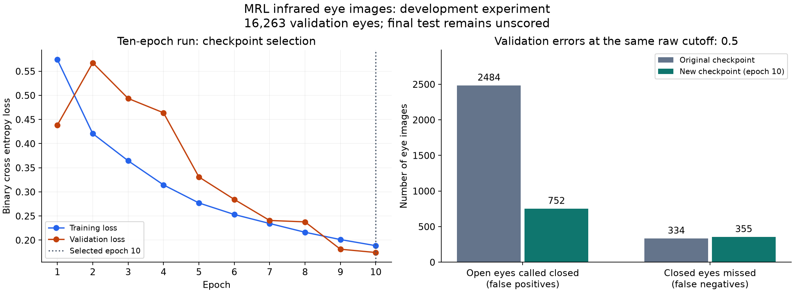

# CNN handoff and local training experiment

Date: 9 November 2026. Workspace branch: cognition-integration.

## Requirement and decision

Continue Arushi's CNN work on the laptop, measure whether the existing small
network can improve, and preserve evidence before using it in camera fusion.
The user authorized the recommended experiment. Used a longer fit of the existing
EyeCNN because it tests a simple development option before changing architecture.
Threshold adjustment alone had already traded fewer false positives for many
missed closures. A larger architecture would add another variable before the
existing baseline was reproduced.

The experiment trains from seed 7 for ten epochs, using the existing subject split,
grayscale 64 by 32 preprocessing, Adam at learning rate 0.001, batch size 32,
and binary cross entropy with logits. The saved checkpoint is whichever epoch
has the lowest validation loss, not necessarily epoch ten. This is a fresh fit,
not a resume of Arushi's optimizer. Her baseline used CPU; this run uses the
RTX 3050 with PyTorch 2.14.1+cu126. The comparison therefore does not isolate
epoch count from backend differences or establish repeatability across seeds.

## Artifact handoff and dataset reproduction

The baseline checkpoint was obtained from the attachment linked in the team's
[GitHub release](https://github.com/driver-drowsiness-detection/driver-drowsiness-detection/releases/tag/mrl-eye-cnn-epoch3-v1).
The release itself had no release assets; the checkpoint ZIP was in its body.
The extracted checkpoint matched the previously recorded SHA256 before use.

| Item | Verified identity |
| :--- | :--- |
| Baseline checkpoint | f33202048a72f14e0aeb2aa4d5dae622af036d56619c52e815dca534d8bb75bd |
| Recreated baseline ONNX | da843bb78db4696989b855abbce26597a16ff39c6d8153a461820a15b354d756 |
| Official MRL archive | 17ff89928005cb6e63a53fe020e419060279ff59e57555cfa49693fc1865fdfc |
| Recreated manifest | 7e89b9ef46ece634229238db8d37e8f04b2653ded6c18f0562832831fb893cbc |

The archive came from the [MRL authors' dataset page](https://mrl.cs.vsb.cz/eyedataset.html).
Its size is 341,866,898 bytes. The importer checked archive CRC and structure,
then extracted 84,898 PNGs. The recreated manifest hash exactly matches the
training-manifest hash embedded in Arushi's checkpoint. Images, checkpoints,
exports and detailed reports remain local and ignored by Git.

| Partition | Subjects | Eyes | Role in this experiment |
| :--- | ---: | ---: | :--- |
| Train | 25 | 54,617 | Fit model weights |
| Calibration | 4 | 10,317 | Fit temperature and select threshold candidates |
| Validation | 4 | 16,263 | Select checkpoint and compare development errors |
| Test | 4 | 3,701 | No inference or scoring |

File validation and exact duplicate auditing inspect all partitions, including
test files. That integrity audit does not run inference or use test performance
to select a model. Exact hashes cannot detect every near duplicate.

## Reproduced baseline

On the same 16,263 validation eyes at raw cutoff 0.5, the downloaded checkpoint
produced TP 8,392, TN 5,053, FP 2,484 and FN 334: accuracy 82.6723%, closed-eye
recall 96.1724%, precision 77.1607%, F1 85.6239%, and open-eye FPR 32.9574%.
Arushi's recorded report had TN 5,054 and FP 2,483. The current result therefore
differs by one open-eye decision; it is not an exact numerical reproduction.
The cause of this small discrepancy has not been isolated.

Temperature fitting again improved calibration NLL but worsened validation NLL
from 0.400277 to 0.409328. This does not justify installing that temperature as
a validated runtime setting.

Detailed baseline: reports/runs/mrl_baseline_local_2026_11_09.json.

## Completed ten-epoch result

Epoch ten had the lowest validation loss, 0.174283, and was retained. Within
this GPU run, epoch three had validation loss 0.493516. The complete history,
audit, hashes, thresholds and subject/condition metrics are preserved in
[the shared evidence JSON](evidence/mrl_local_comparison_2026_11_09.json).

At the same raw 0.5 cutoff on the same validation eyes:

| Metric | Original checkpoint | New epoch-ten checkpoint |
| :--- | ---: | ---: |
| Accuracy | 82.67% | 93.19% |
| Closed-eye precision | 77.16% | 91.76% |
| Closed-eye recall | 96.17% | 95.93% |
| Closed-eye F1 | 85.62% | 93.80% |
| Open-eye FPR | 32.96% | 9.98% |
| Open eyes called closed (FP) | 2,484 | 752 |
| Closed eyes missed (FN) | 334 | 355 |

False positives fell by 69.73%, while missed closures increased by 21. The
10.52 percentage-point accuracy improvement is an aggregate MRL validation
result. It does not mean every participant improved.



### Subject failures that the average hides

| Subject | Open examples | Original FP | New FP | Original closed recall | New closed recall |
| :--- | ---: | ---: | ---: | ---: | ---: |
| s0005 | 28 | 28 | 25 | 93.93% | 97.60% |
| s0007 | 11 | 11 | 11 | 98.04% | 84.99% |
| s0012 | 4,230 | 1,372 | 498 | 94.66% | 95.35% |
| s0019 | 3,268 | 1,073 | 218 | 98.66% | 98.73% |

Subject s0007 now has 92 missed closed eyes, compared with 12 originally. All
11 open eyes from that subject are still misclassified. The small open-eye
counts for s0005 and s0007 make those rates unstable, but they do not make
the failures disappear. Thousands of correlated images from four subjects
do not constitute thousands of independent participant tests.

### Calibration and alternative operating points

Temperature 1.926593 improves calibration NLL from 0.349945 to 0.283579 but
worsens validation NLL from 0.174248 to 0.223370. Validation Brier also worsens
from 0.050179 to 0.060512 and ECE from 0.021323 to 0.089551. Retained raw
scores for the default experimental comparison; did not adopt this temperature
as validated runtime probability calibration.

The existing script also selected the following development candidates using
only calibration subjects. No threshold was selected from final-test results.

| Candidate | Cutoff and scale | Validation recall | Validation open FPR | FP | FN |
| :--- | :--- | ---: | ---: | ---: | ---: |
| Fixed baseline | Raw 0.5 | 95.93% | 9.98% | 752 | 355 |
| Maximum calibration F1 | Temperature-scaled 0.470617549 | 96.75% | 11.46% | 864 | 284 |
| Calibration recall at least 95% | Raw 0.544349259 | 95.32% | 8.85% | 667 | 408 |
| Calibration open FPR at most 5% | Temperature-scaled 0.758849490 | 77.73% | 1.39% | 105 | 1,943 |

The F1 candidate reduces both error counts relative to the original raw-0.5
baseline. Using the same calibration-F1 selection procedure for both models
also favors the new model: original FP 2,504 / FN 328, new FP 864 / FN 284.
Its decision cutoff is mathematically equivalent to raw score approximately
0.443568151 because temperature scaling is monotonic. This equivalence does
not validate the temperature as a probability model. Even this candidate has
only 89.72% closed-eye recall for s0007, so aggregate gains do not resolve the
subject weakness. None of these settings was installed as a live alert policy.

Decision: retain epoch ten as the next CNN development candidate because it
substantially reduces aggregate MRL errors; prioritize independently reviewed
RGB camera data before further model or fusion claims. Keep the original
checkpoint available for comparison. The test split remains unscored.

## New artifact and execution verification

| Artifact | Location or identity |
| :--- | :--- |
| Checkpoint | models/checkpoints/mrl_full_10epoch_gpu_2026_11_09.pt |
| Checkpoint SHA256 | 92c0fe4bbe1ee6f557eb3885b6819a36e9407207f9e86a38dc07d613c352b780 |
| Training history | Same checkpoint path followed by .history.json |
| ONNX | models/exports/mrl_full_10epoch_gpu_2026_11_09.onnx |
| ONNX SHA256 | 19e1bb58eb6e0f5bfde683d053e8d49f2c5dbf2e1a2bc3e81c94a125ec188886 |
| ONNX metadata | Same ONNX path followed by .json; keep both together |
| Calibration/validation report | reports/runs/mrl_10epoch_local_2026_11_09.json |
| ONNX parity report | reports/runs/mrl_10epoch_onnx_parity_2026_11_09.json |

The new opset-11 graph passed ONNX checking and OpenCV DNN loading. On 100
validation crops stratified by subject and label, maximum absolute logit error
was 0.0000114441, with zero decisions changed at cutoff 0.5 and zero tolerance
failures (absolute and relative tolerance 0.0001). No test images were scored.

The new ONNX also completed the saved-face application check at raw cutoff 0.5.
On the same CEW face as the baseline check, CNN scores were 0.04426 and 0.63494:
one eye open, one closed, yielding bilateral UNKNOWN. EAR returned CLOSED.
The baseline CNN had returned OPEN from scores 0.01918 and 0.37821. The new
model therefore still fails to recover both visible closed eyes in this example.
This one image is a concrete transfer failure, not a measured RGB accuracy rate
or proof of its cause. Log: reports/local/cnn_10epoch_image_smoke_2026_11_09.jsonl.

Focused regression checks passed: 11 tests across test_cnn_pipeline.py,
test_cnn_calibration.py and test_cnn_export.py in 51.33 seconds. No model,
training or runtime source was modified for this experiment. An existing
unrelated edit to the logger was preserved. No camera or audio was opened
during this continuation; the application check used a saved image.

## Reproduce and continue

Use fresh output names when repeating because training, export and evaluation
scripts refuse overwrite. Commands used for this completed experiment:

```powershell
$env:OMP_NUM_THREADS = '4'
$env:MKL_NUM_THREADS = '4'
.\.venv-cognition\Scripts\python.exe -u scripts/train_cnn.py data/processed/mrl_manifest_v1.csv models/checkpoints/mrl_full_10epoch_gpu_2026_11_09.pt 10 cuda
.\.venv-cognition\Scripts\python.exe scripts/calibrate_cnn.py data/processed/mrl_manifest_v1.csv models/checkpoints/mrl_full_10epoch_gpu_2026_11_09.pt reports/runs/mrl_10epoch_local_2026_11_09.json cuda
.\.venv-cognition\Scripts\python.exe scripts/export_onnx.py models/checkpoints/mrl_full_10epoch_gpu_2026_11_09.pt models/exports/mrl_full_10epoch_gpu_2026_11_09.onnx
.\.venv-cognition\Scripts\python.exe scripts/check_onnx.py data/processed/mrl_manifest_v1.csv models/checkpoints/mrl_full_10epoch_gpu_2026_11_09.pt models/exports/mrl_full_10epoch_gpu_2026_11_09.onnx reports/runs/mrl_10epoch_onnx_parity_2026_11_09.json
```

For a future stationary camera check, this displays/logs the candidate while
keeping EAR as the selected alert source. It does not create labelled video:

```powershell
.\.venv-cognition\Scripts\python.exe scripts/run_cognition.py --camera --display --ear-threshold 0.2 --cnn-onnx models/exports/mrl_full_10epoch_gpu_2026_11_09.onnx --cnn-threshold 0.5 --alert-mode ear --max-seconds 90 --output reports/local/camera_new_cnn_check_01.jsonl
```

The next accuracy prerequisite is the [camera collection and review protocol](CAMERA_EVALUATION_COLLECTION.md),
followed by the [EAR/CNN calibration and fusion workflow](FUSION_CALIBRATION_WORKFLOW.md).

## Conversion and application checks

The original checkpoint was exported locally to ONNX opset 11. Its ONNX hash
exactly matched Arushi's recorded export. On 100 existing CEW eye crops,
PyTorch and OpenCV ONNX had maximum absolute logit error 0.0000057221 and zero
classification disagreements. This checks conversion parity, not correctness
against eye labels or Jetson compatibility.

The actual checkpoint also completed a saved-face application smoke run.
On that single CEW face, EAR returned CLOSED and CNN returned OPEN. Visual
inspection showed closed eyes; this is a useful error example, not a dataset
accuracy measurement. It motivates checking transfer to RGB camera crops.

Local evidence:

* reports/local/cnn_continuation_2026_11_09_onnx_parity.json
* reports/local/cnn_handoff_smoke_422179bf.jsonl

## What this can establish

```text
MRL infrared eye crops
        |
        v
Fit CNN on training subjects
        |
        v
Choose epoch on validation loss
        |
        v
Fit score options on calibration subjects
        |
        v
Compare validation errors and subject breakdowns
        |
        v
Candidate for further camera evaluation

Independently labelled full RGB camera frames are still needed
        |
        v
Aligned EAR and CNN measurements, fitted EAR mapping
        |
        v
EAR alone vs CNN alone vs fusion, with coverage and event evaluation
```

MRL has no anatomical eye pairing or actual video timestamps. This experiment
cannot prove fusion improvement, RGB camera accuracy, temporal alert quality,
PERCLOS validity or Nano readiness. Validation was used to select the epoch;
its results are development evidence, not an unbiased final test.

## Terms and interpretation

An epoch is one pass through the training partition. The optimizer changes
weights only on training batches. Validation loss measures how the current
weights perform on separate subjects and selects the saved epoch.

Closed-eye recall is TP / (TP + FN): how many labelled closed eyes are caught.
Open-eye FPR is FP / (FP + TN): how many labelled open eyes are called closed.
Accuracy combines both outcomes and can hide a bad tradeoff. An image FPR is
not a false-alerts-per-hour rate because the latter depends on pairing, missing
observations and temporal logic.

Temperature rescales logits before sigmoid. With positive temperature and a
0.5 cutoff, class decisions stay unchanged; only scores change. A useful fit
on calibration subjects can still fail to transfer to validation subjects.

Interview explanation: I reproduced a teammate's checkpoint and dataset using
hashes, kept subjects separated, trained a controlled development candidate,
and compared missed closures against false positives. I kept model selection
separate from final testing and did not treat infrared image results as proof
of webcam or fusion accuracy.

Retention question: if validation loss reaches its minimum at epoch six and
training loss keeps falling through epoch ten, which checkpoint should this
experiment save? Epoch six, because the declared selection rule uses validation
loss. Lower training loss alone does not establish better generalization.
