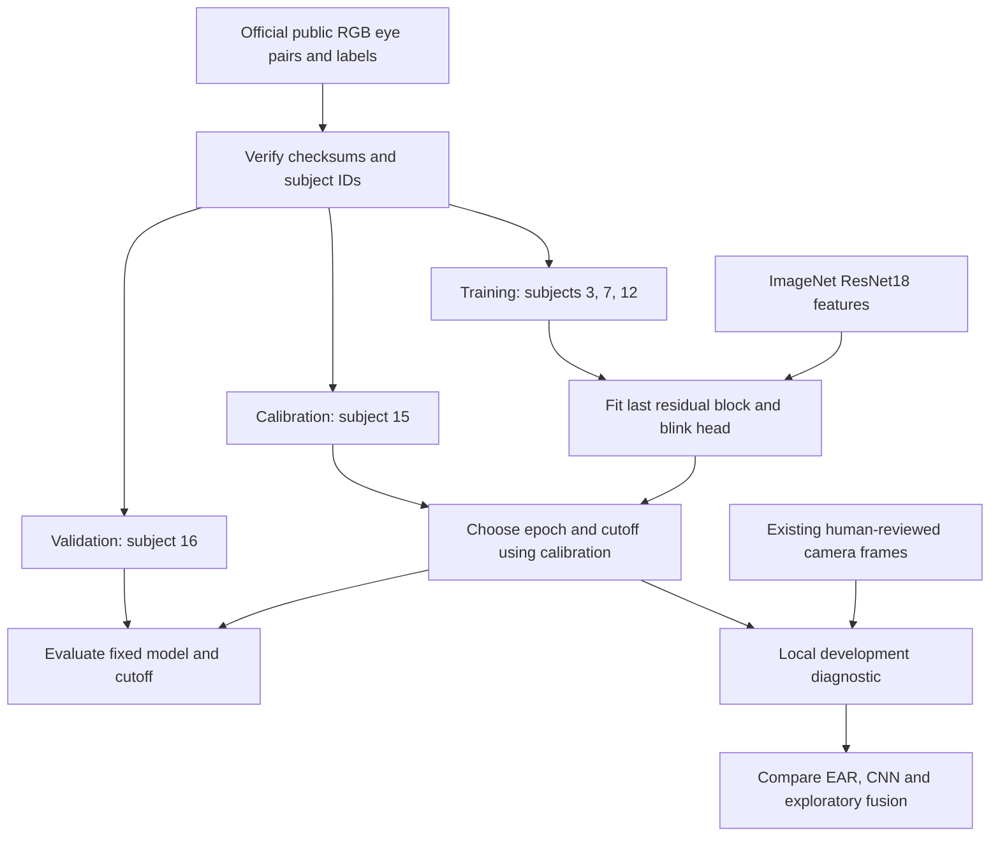
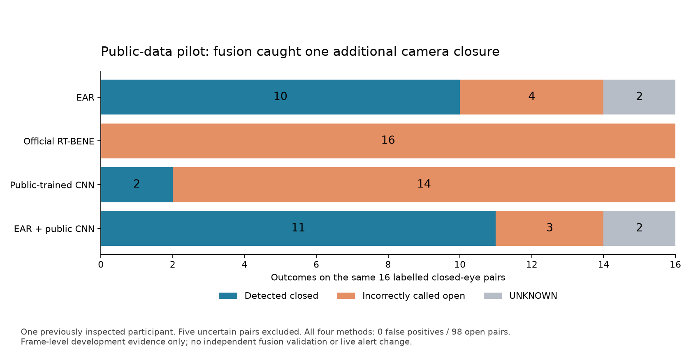

# Public RGB data and pretrained model experiment

## Requirement and decision

Use existing public annotations and pretrained features to reduce manual collection.
The user explicitly chose public datasets instead of asking teammates to record.
Used RT-BENE because its official release provides labelled colour eye pairs,
subject identities, downloadable weights and checksums. This is a bounded pilot.
It does not establish driver drowsiness accuracy or laptop deployment readiness.

Three possible routes were considered:

1. Run the published blink checkpoint unchanged. Fastest, but its preprocessing
   and training provenance must be checked and transfer may fail.
2. Adapt ImageNet features using public blink labels with separate subjects.
   More work, but offers control over the data, inputs and evaluation partitions.
3. Collect new local recordings. Closest to the device but imposes manual review.
   The user chose the public route, so this is not the immediate requirement.

## Concepts that determine whether the result is credible

* A labelled dataset supplies examples and answers. A pretrained model supplies
  learned weights. They are different assets; neither guarantees camera accuracy.
* Transfer learning starts with learned features and adapts them to a new task.
* Domain shift means different inputs at use time, such as lighting, glasses,
  camera optics, eye size and crop preparation.
* Subject separation keeps every image of a person in one partition. Adjacent
  frames split randomly would leak nearly identical examples across partitions.
* Calibration chooses the operating cutoff. Validation measures a fixed choice
  on another person. A repeatedly inspected validation set becomes development
  evidence, so a later final evaluation still needs untouched subjects.
* Recall counts detected closures divided by actual closures. Open-eye false
  positive rate counts open eyes called closed divided by all labelled open eyes.
* Coverage counts observations where a method produces a valid binary decision.
  A bilateral disagreement is UNKNOWN, not OPEN and not a correct prediction.



## Official checkpoint compatibility experiment

Pinned upstream commit: fa46a87e5f6fdc6f13be5d59572037c29ff9fc8b.
Archived training source: 450ad3d66ecb06d8845d5d0794a35fd0e429293b.
Official ResNet18 model 1 MD5: 7c228fe7b95ce5960c4c5cae8f2d3a09.
The downloaded 91,643,688-byte file matched this checksum and loaded strictly
with weights-only deserialization. TorchVision 0.29.1+cu126 was added to the
existing Torch 2.14.1+cu126 environment; pip check passed.

RT-BENE outputs one score for a pair of eyes. The comparison therefore uses
114 labelled pairs: 98 open and 16 closed. Five uncertain pairs are excluded.
Do not compare these counts directly with the earlier 228 individual-eye table.

At a fixed 0.5 cutoff, the official checkpoint detected zero camera closures.
Both existing MARVEL crops and an aligned crop variant produced that result.
On public subject s012 it detected zero of 23 closures among 935 usable pairs.
There were 336 public annotation disagreements, excluded as specified by the
dataset. The public result is a source-data compatibility check, not independent
validation of an all-subjects checkpoint. The 97.54% public accuracy is misleading:
predicting OPEN for every example achieves exactly that number.

The upstream OpenCV inference path keeps BGR channels. The archived training
utilities instead use PIL RGB and an intermediate 224-square resize. An explicitly
recorded follow-up used that RGB resize path, with real distinct left/right eyes;
it also detected zero closures at 0.5 on camera and s012. The archived HDF5 builder
appears to write the left array into the right dataset. We have not established
whether the published checkpoint was trained with that version, and do not claim
that this apparent source defect caused the observed failure.

Anatomical eye ordering follows upstream 42/45 for left and 36/39 for right.
The local aligned variant substitutes MediaPipe corners and a full-frame
alignment canvas for the upstream face detector/face box. This changes intermediate
resampling and is an adapter experiment, not an exact full-pipeline reproduction.
All threshold and preparation variants must remain visible in the record.

## Controlled public training experiment

The follow-up starts from torchvision ResNet18 IMAGENET1K_V1, not the RT-BENE
all-subjects checkpoint. Otherwise its prior exposure could contaminate the new
subject split. Each eye has a separate ResNet18 feature branch; concatenated
features feed the upstream 512-unit blink head.

Training is fixed at five epochs with seed 20261110, batch size 64, AdamW learning
rate 0.0001 and weight decay 0.01. Early backbone layers and their BatchNorm
statistics remain frozen. The final residual block and blink head are trainable.
Positive-class weight is computed only from training counts. Inputs are actual
left and right RGB crops, resized with OpenCV cubic interpolation to 60 by 36,
scaled by 255 and normalized with the ImageNet channel statistics.

The epoch with lowest unweighted calibration binary cross entropy is retained.
The cutoff maximizes closure recall while keeping empirical calibration open-eye
false positive rate at or below 5%. This constraint applies to calibration only;
it is not a guaranteed false positive rate for validation or a real camera.
Validation is scored only after epoch and cutoff choices are complete.

The importer verifies official checksums, reads archive members without extraction,
excludes label 0.5 and uses both real eye images. Hashes of resized eye pairs are
checked across partitions. Any exact cross-partition copies are excluded from
both sides. This does not detect every near-duplicate or establish broad diversity.

## Measured public training result

The training run completed in approximately 22 seconds after input preparation
on the laptop GPU. There were 5997 training pairs with 339 closures, 1810
calibration pairs with 29 closures, and 4549 validation pairs with 42 closures.
No exact pair duplicates crossed partitions. Excluded annotation disagreements:
252 for s003, 73 for s007, 336 for s012, 407 for s015 and 111 for s016.

Calibration selected epoch 2 and cutoff 0.9487019777. At that cutoff:

| Partition | Detected closures | Missed closures | Open false positives | Closure recall |
| :--- | ---: | ---: | ---: | ---: |
| Public calibration s015 | 12 / 29 | 17 | 71 / 1781 | 41.38% |
| Public validation s016 | 16 / 42 | 26 | 7 / 4507 | 38.10% |
| Local camera diagnostic | 2 / 16 | 14 | 0 / 98 | 12.50% |

Validation accuracy is 99.27%, but the model misses 61.90% of closures. Accuracy
alone hides the failure because 99.08% of this validation subject's labels are
open. At the fixed 0.5 cutoff, validation detected 23/42 closures but produced
445/4507 open false positives. The selected cutoff trades sensitivity for fewer
false positives; it does not make the system deployment ready.

On the identical 114 reviewed camera pairs:

| Method | Detected / 16 closed | Predicted OPEN on closed | UNKNOWN on closed | False positives / 98 open |
| :--- | ---: | ---: | ---: | ---: |
| EAR at 0.2 | 10 | 4 | 2 | 0 |
| Official pretrained RT-BENE at 0.5 | 0 | 16 | 0 | 0 |
| Public-trained pilot at public cutoff | 2 | 14 | 0 | 0 |
| EAR OR public-trained pilot | 11 | 3 | 2 | 0 |

Fusion detects one additional closure. All-closure recall changes from 62.50%
to 68.75%. This is a small observed improvement on one already inspected person's
sampled frames, not a statistically established or independent fusion gain.
These are frame observations, not 16 independent closure events. UNKNOWN outcomes
are explicitly counted; conditional accuracy on covered cases must not conceal them.



The [aggregate evidence JSON](evidence/rt_bene_public_data_2026_11_10.json) retains
both failed official-model experiments and the public pilot, including counts,
thresholds, hashes and epoch history. Detailed sample scores remain local.

The pilot checkpoint SHA256 is
`0c7d4e75c98c2b43f33921c909eddddaa05d6a309b7d5cd842a32da810f41b91`.
ImageNet initialization SHA256 is
`f37072fd47e89c5e827621c5baffa7500819f7896bbacec160b1a16c560e07ec`.
The seed is recorded, but bitwise-identical CUDA reruns are not guaranteed.

The next accuracy work is broader public subject coverage and a labelled
full-face public benchmark for EAR/CNN fusion. RT-BENE supplies eye patches,
so it can train the paired CNN but cannot validate this project's full-face
landmark extraction, sustained closure timing or false warnings per hour.
Keep the current live EAR configuration until stronger evidence supports a change.

## Code map and mechanisms

* `rt_bene_model.py` retains the official ResNet18 architecture. Each branch
  maps an eye into 512 features. Concatenation creates 1024 features; the head
  produces one logit. Sigmoid converts it to a closure score.
* `rt_bene.py` verifies the official checkpoint before loading, reproduces its
  input normalization, validates same-frame eye pairing and constructs aligned
  crops. UNKNOWN labels never become invented binary truth.
* `evaluate_rt_bene.py` compares unchanged weights on identical reviewed pairs
  and reports abstentions alongside confusion counts. OR fusion calls CLOSED
  when either method calls CLOSED; consensus requires agreement. These are
  diagnostic rules, not fitted or deployed fusion weights.
* `download_rt_bene_pilot.py` obtains a small named subset from official URLs and
  verifies every file. A failed download remains a partial file.
* `train_rt_bene_pilot.py` assigns subjects before learning, audits inputs,
  freezes early features, fits on training, selects on calibration, then evaluates
  validation and the already inspected local camera diagnostic.

The existing camera recording is never used in a gradient step or to select the
public model's cutoff. It is nevertheless a development diagnostic because it
has already influenced the project direction. It is not a fresh final test.

## Reproduction

Run from the repository root in the existing Windows GPU environment.
The public training script refuses to overwrite an existing checkpoint. Use a
new experiment name in the script for a deliberate rerun and retain the old run.

```powershell
$env:PYTHONPATH = 'src'
.\.venv-cognition\Scripts\python.exe -m pip install --no-deps -r environments/windows-rt-bene.txt
.\.venv-cognition\Scripts\python.exe scripts/download_rt_bene_pilot.py
.\.venv-cognition\Scripts\python.exe scripts/train_rt_bene_pilot.py
.\.venv-cognition\Scripts\python.exe -m pytest tests/test_rt_bene.py tests/test_fusion.py tests/test_comparison.py tests/test_dataset.py -q
```

Official checkpoint URL and hash are constants in `rt_bene.py`. Its separate
diagnostic command is `scripts/evaluate_rt_bene.py`; use `--help` for required
manifest, baseline score, public dataset and output paths.

Validation completed: 40 focused tests passed, including input channel ordering,
anatomical pairing, uncertain labels, UNKNOWN accounting, checkpoint rejection
and cross-partition duplicate exclusion. Actual model loading, five training
epochs, calibration, public validation and camera scoring completed successfully.
The experiment's statistical limitations remain even though the software checks pass.

## Sources and attribution

RT-BENE is by Kevin Cortacero, Tobias Fischer and Yiannis Demiris, ICCV Workshops
2019. Its code and dataset use CC BY-NC-SA 4.0. Retained and adapted RT-BENE
code carries attribution and the same license notice; this experiment does not
relicense unrelated project files. Data and weights stay in ignored local folders.

* [Official dataset, annotations and checksums](https://zenodo.org/records/3685316)
* [Pinned upstream model and inference source](https://github.com/Tobias-Fischer/rt_gene/tree/fa46a87e5f6fdc6f13be5d59572037c29ff9fc8b/rt_gene_core/src/rt_bene)
* [Archived training utilities](https://github.com/Tobias-Fischer/rt_gene/tree/450ad3d66ecb06d8845d5d0794a35fd0e429293b/rt_bene_model_training/pytorch)
* [License](https://creativecommons.org/licenses/by-nc-sa/4.0/legalcode)

Interview explanation: We found that improved infrared-dataset accuracy did not
transfer to a laptop camera. We verified the failure with independent labels,
tested public pretrained weights, then separated public training, calibration and
validation by person. We track missed closures, false positives and abstentions
instead of treating majority-class accuracy as success.

Retention question: If 98 frames are open and 16 are closed, what accuracy does
an always-open classifier achieve, and why would its warning system be useless?
Answer: 98/114 = 85.96% accuracy, but zero closure recall.
