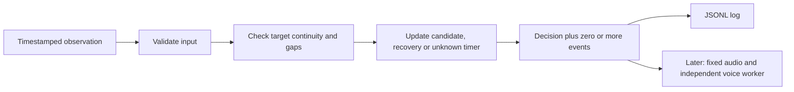

# Temporal controller: first implementation

## Requirement

Turn timestamped `OPEN`, `CLOSED` and `UNKNOWN` observations into traceable prolonged-closure, recovery and monitoring-unavailable events. This module consumes eye-state decisions; it does not compute EAR, run a CNN or diagnose fatigue.

Used elapsed-time state tracking because frame counts depend on capture rate, while a learned sequence model requires labelled sequences. This follows the existing system design. All timing values in the synthetic demonstration are examples, not validated detection settings.

## Concepts and alternatives

| Approach | Mechanism | Tradeoff |
| :--- | :--- | :--- |
| Frame counter | Alert after N closed frames | O(1) per observation, but N frames represent different durations at different FPS |
| Elapsed-time state machine | Remember candidate start times and compare timestamps | O(1) time and memory per observation; explicit gap and validity policies are needed |
| Learned sequence model | Learn patterns across feature sequences | Needs sequence labels, training and inference resources; not needed to implement this controller |

A **state** describes the current controller result. An **event** is a transition record emitted once. An **episode** links one closure event to its later recovery or unresolved target change. A **track** is perception continuity, not a person's identity.

**Debounce** requires evidence to persist before acting. **Recovery persistence** requires sustained reopening before clearing an alarm. The first implementation uses one closure duration and one recovery duration. It does not implement configurable score hysteresis or repeated audio cooldown; those belong to estimator policy and the later sound worker respectively.



## Files and meaningful code blocks

### `src/marvel/cognition/trigger.py`

`Event` is an immutable dataclass. `event_id` identifies one emitted record; `episode_id` refers to the initiating closure record. `sample_id`, `t`, `track` and `mode` make that transition traceable to its observation. `TRACK_ENDED_UNRESOLVED` deliberately names the old track even though a new-track observation caused the transition.

`Decision` is another immutable dataclass. `observation` is the input; `state` is the controller output. `alarm_active` and `episode_id` are independent of observation validity. Thus `state=UNKNOWN` and `alarm_active=True` can correctly coexist. `track` is the last explicit target, while the replay log also stores `source_track`, which can be null.

`Trigger.__init__` checks every duration with `math.isfinite(value)` and `value > 0`. NaN must be rejected explicitly: simple comparisons or a minimum check can otherwise miss it. `mode` separates experiments; `run_id` separates runs. Use one instance for each mode and a unique run identifier for each recorded run.

`closed_since`, `open_since` and `unknown_since` start as `None`. This means there is no current timer. It is different from `0.0`, which is a valid start timestamp. `episode_id=None` means no active closure episode. `unavailable_sent` prevents one unavailable episode from emitting a message at every update.

`_event` increments a counter and constructs an identifier from run, mode and sequence. When closure begins, its event identifier also becomes the episode identifier. Recovery and unresolved-target records retain that episode identifier so consumers can join the records.

`update` follows this order:

1. Validate finite and strictly increasing time, the allowed state, the sample identifier and target. An open/closed observation without a target is rejected. Validation occurs before mutation, so an invalid update cannot advance the controller's clock.
2. When a different explicit target arrives, emit `TRACK_ENDED_UNRESOLVED` if needed, clear the active episode and reset closure/recovery evidence. A missing target on an unknown observation does not falsely end the episode.
3. If the interval since the previous update exceeds `max_gap_s`, clear closure/recovery timers. The old interval cannot provide evidence about eye state. An existing alarm remains outstanding.
4. For `UNKNOWN`, clear closure/recovery timers, start the unavailable timer if necessary and emit at most one notification once its duration is reached. Target changes do not postpone continuous system unavailability.
5. For a valid observation, end the unavailable period. For `CLOSED`, reset reopening evidence and start or continue the closure timer. Emit one `PROLONGED_CLOSURE` event when duration reaches the threshold and no episode is active.
6. For `OPEN`, reset closure evidence and start or continue reopening evidence. If an episode is active and recovery duration is reached, emit `RECOVERED` before clearing its identifier.
7. Return an immutable snapshot. Current unknown takes precedence in the visible state, then an active alarm, then a closure candidate, otherwise open. Events are a tuple, so downstream consumers cannot append records to this decision accidentally.

The controller does not sleep or inspect the wall clock. The caller supplies monotonic live times or recorded media times. Processing the same sequence faster does not change its temporal meaning. Missing time is never counted as eye closure or reopening. After a long gap, unavailable reporting starts from an explicit unknown update; it does not invent past observations.

### `src/marvel/observability/logger.py`

The logger creates parent directories and opens a new file with mode `x`, which refuses an existing path. `json.dumps(..., allow_nan=False)` serializes the whole record before any write, preventing a malformed partial line when a value is NaN. Each record is written on its own line and flushed. The context manager closes the file on normal completion or an exception.

This is a synchronous baseline logger. Flush does not guarantee disk durability through power loss. Future live integration must measure write latency and decide whether a bounded logging worker is needed. Disk errors currently propagate to the caller rather than being silently ignored.

### `scripts/replay_synthetic.py`

The script generates 81 observations over eight seconds, writes run metadata followed by observation/decision records, and prints emitted events. `dataclasses.asdict` converts nested decisions and events into JSON-compatible dictionaries. Every record is marked synthetic and includes its run identity. The CLI uses a new UUID; tests supply a fixed run identifier to compare exact outputs.

## Run and inspect

From the repository root, choose a new output filename each time:

```powershell
.\.venv-cognition\Scripts\python.exe scripts/replay_synthetic.py reports/local/temporal-first-run.jsonl
.\.venv-cognition\Scripts\python.exe -m pytest tests/test_trigger.py -q -p no:cacheprovider
```

The demonstration uses closure duration 1.5 seconds, recovery duration 0.5 seconds, maximum observation gap 0.25 seconds and unavailable duration 2 seconds.

| Source time | Input/evidence | Expected result |
| :--- | :--- | :--- |
| 0.0 s | Open | No event |
| 1.0 s | Closure starts | `CLOSURE_PENDING` |
| 2.5 s | 1.5 s of sampled valid closure | One `PROLONGED_CLOSURE` event |
| 3.0 s | Reopening starts | Alarm remains outstanding |
| 3.5 s | 0.5 s of reopening | `RECOVERED`, referring to the original episode |
| 4.0 s | Missing observations begin | `UNKNOWN` |
| 6.0 s | 2 s of monitoring unavailability | One `MONITORING_UNAVAILABLE` event |
| 7.0 s | Open observations resume | Unavailable period ends |

An event fires at the first supplied observation that reaches the threshold. There is no claim of continuous visual proof between samples; `max_gap_s` bounds the interval over which the chosen policy accepts continuity.

## Tests and remaining integration

The focused suite contains 39 passing cases covering blink cancellation, threshold crossing, duplicate suppression, interrupted recovery, explicit unknowns, excessive gaps, target changes, bounded unavailable episodes, nonfinite timing settings, invalid inputs without mutation, independent modes, replay provenance and refusal to overwrite logs. The full repository suite passed 101 tests in 54.47 seconds with the landmark asset available and GPU tests enabled. The CLI replay also emitted the three expected events at 2.5, 3.5 and 6.0 seconds.

The controller still requires real EAR/CNN/fusion adapters. The caller must check stale frames and identity alignment before producing bilateral states. A capture stall requires watchdog-driven unknown heartbeat updates: a synchronous controller cannot emit a notification if it is never called. Do not feed timestamps from different clocks into one instance.

PERCLOS, pose, audio, LLM generation and TTS are not implemented by this increment. An unavailable notification is separate from a drowsiness warning. No synthetic test establishes detection accuracy, a physical closure criterion, or clinical fatigue labels.

Interview explanation: We separate per-frame eye classification from temporal event generation. A constant-memory state machine uses timestamps, preserves unknown evidence and links alerts to their recovery or unresolved termination. Deterministic replay verifies behavior independently of camera speed, while real sequence data is still required to validate detection quality.

Retention check: an alarm exists, the face disappears for one second, then eyes reopen for less than the recovery duration. Should the alarm be cleared? Explain using the difference between observation validity and episode state.
