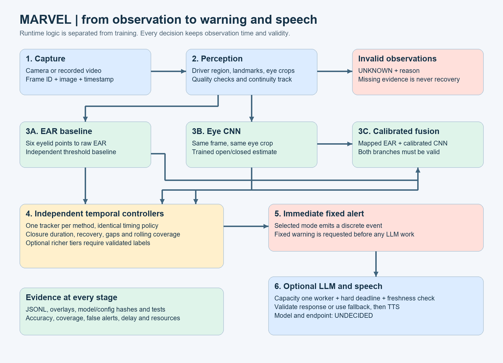
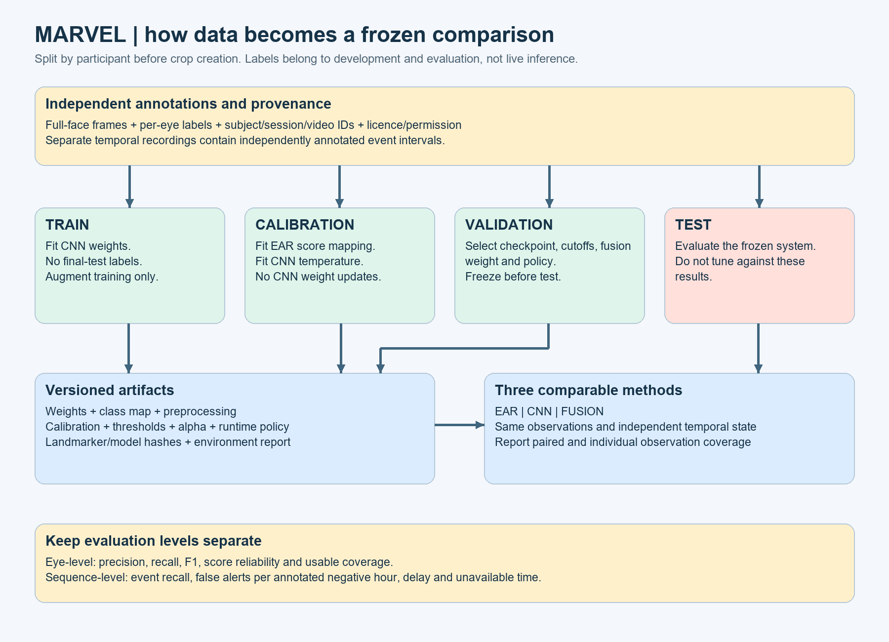

# 01. Architecture and proposal alignment

## Requirement

Build an observable embedded prototype that measures visible eye behavior over time, raises an immediate fixed warning for a configured event, and can describe that event through a local language model and speaker. The project includes the required EAR, CNN and combined experiments.

The original proposal and original technical guide were read from the Downloads paths recovered from the earlier project chat. The revised Phase 1 design and the four earlier learning guides were also inspected. Those documents describe plans, not measured results.

## Prerequisite vocabulary

| Term | Exact meaning here | Example |
| --- | --- | --- |
| Frame | One image with an observation timestamp | BGR array with shape `(480, 640, 3)` |
| Face detection | Locate a face | Face box or face landmark result |
| Landmark | A named point on visible facial geometry | Eyelid corner |
| Recognition | Identify who someone is | Not required for this project |
| Continuity epoch | A temporary track label that prevents mixing separate observations | `track_3` after losing/reacquiring the driver |
| Feature | A measurement derived from input | EAR or MAR |
| Classifier | Map input to an eye-state estimate | Small CNN |
| Calibration | Fit a score mapping using held-out labels | EAR to closure likelihood |
| Fusion | Combine aligned branch evidence | Weighted calibrated scores |
| Temporal logic | Use the order and duration of observations | Confirm sampled closure for 1.5 seconds in a development example |
| Event | A discrete transition that warrants an action | One prolonged-closure event |
| LLM endpoint | Address and contract of the text generation service | Undecided, exposed through a configurable adapter |
| TTS | Convert text into speech audio | Windows SAPI or an evaluated Linux engine |
| Acceptance gate | Evidence required before calling a stage complete | A second person reproduces the run from the saved configuration |

## Four layers and the supporting work

1. **Perception:** capture, timestamps, driver region, facial landmarks, eye crops and validity. Its output describes what was observed. It does not diagnose drowsiness.
2. **Cognition:** geometric measurement, CNN inference, score calibration, fusion, bilateral state and temporal interpretation. Its output contains operational states and events.
3. **Reasoning:** convert an already measured event into a short statement. It cannot change the event threshold or suppress the immediate warning.
4. **Actuation:** request the fixed sound and optional speech. Report whether the request completed or failed.
5. **Supporting work:** dataset preparation, training, evaluation, export, logging and reproducible configuration.

## Three approaches and why the guide uses the middle one

| Approach | How it works | Strength | Limitation |
| --- | --- | --- | --- |
| Pure rules | EAR and time only | Easy to inspect and cheap | Does not satisfy the requested trained CNN comparison |
| Parallel EAR and eye CNN with calibrated fusion | Separate estimates feed the same temporal algorithm | Matches the agreed project scope and supports honest comparison | Needs independent labels and calibration data |
| Learned sequence model | CNN/features feed an LSTM or transformer | Can learn temporal patterns | Requires labelled sequences, more training and a larger validation burden |

The reference implements the second approach. A learned sequence model remains a stretch option. It is not required to connect vision to the LLM.

## Runtime versus development

**Development flow:** collect or obtain licensed data, annotate, group subjects, split, crop, train, calibrate, tune, freeze, evaluate, export.

**Runtime flow:** capture, locate, validate, calculate, classify, combine, update time, emit event, request sound, log, optionally request speech.

The runtime never receives ground-truth labels. A training script may read labels. The live predictor may not.

## Proposal requirements mapped to this package

| Proposal item | Implementation or procedure | Acceptance condition |
| --- | --- | --- |
| Camera and landmarks | Guide 03 | Correct timestamped frames and visually checked eye points |
| EAR/MAR/head pose | Guide 04 | Geometry tests, MAR convention, calibrated PnP checks |
| Eye CNN and EAR comparison added later | Guides 05 and 06 | Separate and combined reports on identical data |
| PERCLOS and hysteresis | Guide 07 | Observed-time closure statistic and coverage, validated interpretation |
| Alert, mild fatigue, drowsy, microsleep labels | Optional policy in Guide 07 | Independent sequence labels and evidence before assigning these names |
| ONNX and TensorRT optimization | Guide 11 | Export correctness, target parser compatibility, parity and measured benefit |
| Small local LLM | Guide 09 | Endpoint/model chosen after compatibility and memory measurements |
| On-device TTS and speaker | Guides 08 and 09 | Audible output, interruption, timeout and target engine validation |
| Public benchmark evaluation | Guide 10 | Dataset licence/schema audit and appropriate frame/event labels |
| Companion-device fallback | Guide 09 | Local telemetry-only request, offline failure handling and disclosure |

## Corrections that preserve the aim

1. CNN is not guaranteed to beat EAR. Fusion is not guaranteed to beat either one. Report the actual result, including losses.
2. A single closed-eye crop cannot establish drowsiness or microsleep. Temporal observation is required, and a clinical sleep state is not established by this prototype.
3. The sample rolling statistic is a **closure-fraction proxy**, not automatically validated PERCLOS with a physical 80 percent eyelid-closure definition. See Guide 07.
4. A GPIO buzzer driven by this Python application still depends on software. A separate hardware watchdog would need its own circuit and validation.
5. Fixed warning comes before language generation. The proposal's serial vision to LLM to warning path is replaced by two output paths.
6. CLAHE cannot recover visual information that the sensor did not capture. It is an optional preprocessing experiment, not a night-vision guarantee.
7. A 4-bit model still requires memory for its runtime, context and cache. Parameter count alone cannot establish simultaneous CV and LLM feasibility.
8. Report precision, recall, coverage, false alerts and latency. The proposal's FPS and accuracy figures are aspirations until measured.

## Scope boundary for the reference

The perception adapter targets a controlled single-driver scene. It rejects multiple visible faces and uses a configured driver region. Its continuity check is a simple centroid heuristic. It cannot prove that a smoothly substituted person is the same driver. Reset between participants and add an evaluated tracking association policy before multioccupant use.

The exact Jetson landmarker package, TensorRT execution adapter and chosen neural speech engine remain platform decisions. The complete portable path is supplied; target-specific deployment procedures explicitly stop where board evidence is required. That is more accurate than inventing a compatible wheel, GPIO pin or model download.

## Notes and interview explanation

Used separate perception, cognition and output modules because camera libraries, inference runtimes and speech engines can change without rewriting the geometry and temporal rules.

Interview explanation: “We compare geometric EAR, an eye-image CNN and calibrated fusion using identical recordings and independent temporal trackers. Quality gates preserve missing observations as unknown. Immediate warnings are deterministic; optional local language generation is downstream and bounded by a deadline.”

Retention check: if a CNN returns 0.95 closure confidence from an old frame, should the system act on it? Explain why freshness is part of evidence validity, not just a performance metric.
