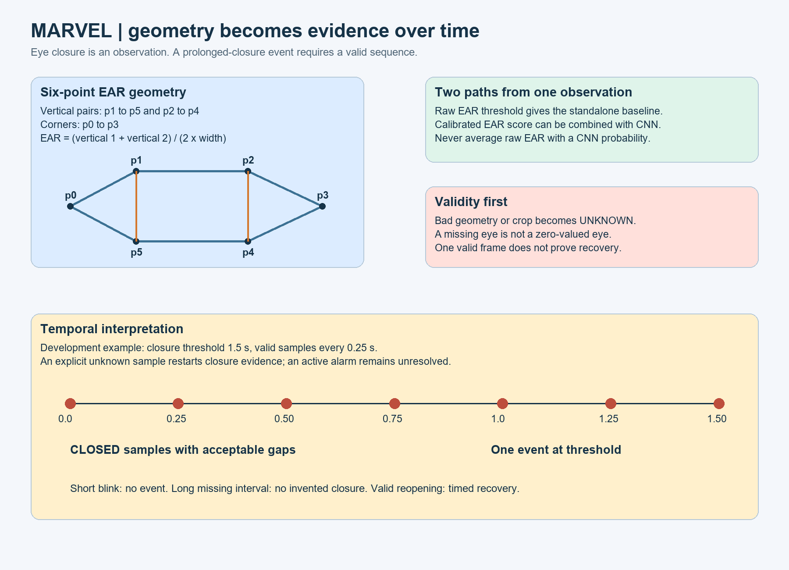

# 04. EAR, MAR and head pose

## Requirement

Convert named facial points into interpretable measurements. Keep geometry independent of OpenCV, MediaPipe and the camera so it can be tested with hand-calculated examples.

## Prerequisites

Know tuples, function returns, `None`, Euclidean distance, ratios, finite numbers and coordinate systems. `math.dist(a, b)` returns the straight-line distance between two coordinate tuples. A ratio divides quantities with the same unit and removes uniform scale.

## EAR derivation and example

For six ordered points `p0` through `p5`:

\[
EAR = \frac{\lVert p_1-p_5\rVert + \lVert p_2-p_4\rVert}{2\lVert p_0-p_3\rVert}.
\]



The two vertical distances measure eyelid separation. Their average is divided by eye width. A uniformly larger image scales numerator and denominator equally, leaving the ratio unchanged. Rotation in the image plane also preserves these distances. Out-of-plane head rotation changes the projected geometry and is not removed by this ratio.

For the test points `(0,0), (1,1), (3,1), (4,0), (3,-1), (1,-1)`, both vertical distances are 2 and width is 4. EAR is `(2+2)/(2*4)=0.5`. If all y coordinates become 0 while corners remain separated, EAR is 0 and is mathematically valid. If the corners coincide, return `None` because division by zero would be meaningless.

## `aspect_ratio` explained in execution order

1. Check that six two-dimensional points were supplied.
2. Check that every coordinate is finite. NaN can otherwise pass through comparisons in surprising ways.
3. Measure corner distance.
4. Reject a width below the declared minimum. Tiny geometry is numerically and visually unreliable.
5. Measure the two vertical distances, sum, divide by twice the width.

Runtime and memory complexity are O(1): exactly six points are processed.

## EAR-only classification

Three realistic options:

| Option | Mechanism | Benefit | Cost |
| --- | --- | --- | --- |
| Global threshold | Closed if EAR is below a fitted cutoff | Transparent baseline | People and viewpoints differ |
| Guided personal calibration | Normalize against a measured open-eye reference | Adapts to eye shape | Needs a trustworthy calibration session |
| Small learned geometric classifier | Fit logistic regression/SVM to features | Can combine measurements | Adds labels, fit and generalization checks |

The reference preserves a raw global-threshold baseline. Fit its cutoff using validation data. The `0.20` in the starter configuration is only a development example.

`measure(eye)` computes raw EAR only when geometry is valid. `state(estimate, threshold)` converts a valid value to open or closed. `probability(estimate, calibration)` supplies a separately fitted score for fusion. Do not confuse these two decision paths.

For guided calibration later, collect verified open-eye observations, choose a robust reference such as a median, freeze it for the session, and evaluate on separate samples. Do not silently adapt the reference while the person is closing their eyes; that can normalize the event away.

## MAR: measurement rather than a yawn label

The reference uses the same six-point ratio with the explicit inner-mouth indices in `detection.py`. Its denominator is twice mouth width and its numerator sums two inner-lip vertical distances.

Log MAR as a supporting measurement. High MAR can come from speaking, singing, mouth breathing or yawning. It does not directly trigger the eye-closure alarm. A yawn detector requires its own duration, context and independent annotations.

Compare mouth measurements only when the formula and point ordering match. A threshold copied from a different MAR definition has no guaranteed meaning.

## Head pose is included, with required inputs exposed

Head pose asks how a head is oriented relative to the camera. PnP estimates rotation and translation from corresponding 3D reference points and 2D image points.

You need:

1. Camera intrinsic matrix: focal lengths and principal point.
2. Distortion coefficients for the same camera and resolution.
3. Six 3D reference points whose ordering matches nose tip, chin, two outer eye corners and two mouth corners.
4. An explicit 3D axis convention and measured reprojection error limit.

The camera calibration script creates intrinsics from checkerboard images. It does not invent the facial 3D template. `pose_object_points` and the pose axis convention remain undecided until you choose and document a template.

```powershell
python scripts\calibrate_camera.py data\checkerboard 9 6 25 models\intrinsics.json
```

Here 9 and 6 mean **inner corners**, and 25 means measured square size in millimetres. These numbers are an example board, not a claim about the board you own. Capture varied orientations and positions at the actual runtime resolution. Use at least ten accepted views, then inspect reprojection error and held-out views. Ten repeated nearly identical views are not sufficient calibration evidence.

To enable pose, create a reviewed JSON file with `image_size`, `camera_matrix`, `distortion`, `object_points` and `max_reprojection_px`. `object_points` must be a 6 by 3 list in the exact `POSE` order. Set `pose_calibration` to that file. The reference checks the image resolution, PnP result, positive depth and reprojection error.

`Rodrigues` converts rotation-vector representation into a rotation matrix. `RQDecomp3x3` gives Euler angles. The labels pitch/yaw/roll only acquire physical meaning after your camera and template axes are documented and tested. Do not treat a generic face template as a precision head-tracking calibration.

Pose is logged, not used to invent fatigue. After validation, it may become an observation-quality gate or an independent distraction feature. Freeze and evaluate that policy separately.

## Failure cases and tests

| Case | Expected behavior |
| --- | --- |
| Scaled or translated valid eye | Same EAR |
| Collinear closed eyelid | Valid low EAR |
| Coincident corners | Missing geometry |
| NaN point | Missing geometry |
| One invalid eye | Bilateral unknown |
| Wrong pose resolution | Pose invalid with reason |
| Missing camera calibration | Pose remains undecided |
| Head turn causing wrong eyelid placement | Quality failure or documented limitation; no guaranteed correction |

Used raw EAR as the baseline because it is interpretable and cheap. Used a separate score mapping because EAR is not a probability.

Interview explanation: “EAR normalizes eyelid separation by eye width. It is invariant to uniform image scaling but remains sensitive to pose and landmark errors. We test geometry independently and use held-out calibration before combining it with a CNN.”

Retention check: if only image width doubles while height stays the same, why can EAR change? Connect the answer to using pixel coordinates and avoiding anisotropic geometry resizing.

<!-- CODE -->

## Complete source files

### File: `src/marvel/cognition/features.py`

[Open the companion file](reference/src/marvel/cognition/features.py). Copy the complete block to this path in your reviewed implementation.

Reading map, using line numbers in the companion file:

* `aspect_ratio`: lines 4 to 14. Six ordered points: corners 0/3, vertical pairs 1/5 and 2/4.
* `sigmoid`: lines 17 to 21.

```python
import math


def aspect_ratio(points, min_width=2.0):
    """Six ordered points: corners 0/3, vertical pairs 1/5 and 2/4."""
    if len(points) != 6 or any(len(p) != 2 for p in points):
        return None
    if not all(math.isfinite(v) for p in points for v in p):
        return None
    width = math.dist(points[0], points[3])
    if width < min_width:
        return None
    return (math.dist(points[1], points[5]) +
            math.dist(points[2], points[4])) / (2.0 * width)


def sigmoid(x):
    if x >= 0:
        return 1.0 / (1.0 + math.exp(-x))
    z = math.exp(x)
    return z / (1.0 + z)
```

### File: `src/marvel/cognition/ear_classifier.py`

[Open the companion file](reference/src/marvel/cognition/ear_classifier.py). Copy the complete block to this path in your reviewed implementation.

Reading map, using line numbers in the companion file:

* `measure`: lines 5 to 8.
* `state`: lines 11 to 14.
* `probability`: lines 17 to 23.

```python
from marvel.contracts import Estimate, OPEN, CLOSED, UNKNOWN
from .features import aspect_ratio, sigmoid


def measure(eye):
    value = aspect_ratio(eye.points) if eye.geometry_ok else None
    return Estimate(eye.sample_id, eye.t, eye.track, eye.side, "ear",
                    value, value is not None, "" if value is not None else "geometry")


def state(estimate, threshold):
    if not estimate.valid:
        return UNKNOWN
    return CLOSED if estimate.value < threshold else OPEN


def probability(estimate, calibration):
    slope, intercept = calibration["slope"], calibration["intercept"]
    if slope >= 0:
        raise ValueError("EAR mapping must decrease as eye opening increases")
    value = sigmoid(slope * estimate.value + intercept) if estimate.valid else None
    return Estimate(estimate.sample_id, estimate.t, estimate.track, estimate.side,
                    "ear_probability", value, estimate.valid, estimate.reason)
```

### File: `src/marvel/cognition/pose.py`

[Open the companion file](reference/src/marvel/cognition/pose.py). Copy the complete block to this path in your reviewed implementation.

Reading map, using line numbers in the companion file:

* `estimate_pose`: lines 1 to 27. Optional PnP measurement. Requires real camera calibration + declared 3D template.

```python
def estimate_pose(points, image_shape, calibration):
    """Optional PnP measurement. Requires real camera calibration + declared 3D template."""
    import cv2
    import numpy as np
    if calibration is None:
        return {"valid": False, "reason": "camera_calibration_undecided"}
    h, w = image_shape[:2]
    if calibration["image_size"] != [w, h]:
        return {"valid": False, "reason": "intrinsic_resolution_mismatch"}
    observed = np.asarray(points, dtype=np.float64)
    objects = np.asarray(calibration["object_points"], dtype=np.float64)
    matrix = np.asarray(calibration["camera_matrix"], dtype=np.float64)
    distortion = np.asarray(calibration["distortion"], dtype=np.float64)
    if observed.shape != (6, 2) or objects.shape != (6, 3) or not np.isfinite(observed).all():
        return {"valid": False, "reason": "pose_points"}
    ok, rvec, tvec = cv2.solvePnP(objects, observed, matrix, distortion,
                                 flags=cv2.SOLVEPNP_ITERATIVE)
    if not ok or not np.isfinite(rvec).all() or not np.isfinite(tvec).all() or tvec[2, 0] <= 0:
        return {"valid": False, "reason": "pnp_failed"}
    projected, _ = cv2.projectPoints(objects, rvec, tvec, matrix, distortion)
    error = float(np.linalg.norm(projected.reshape(-1, 2)-observed, axis=1).mean())
    if error > calibration["max_reprojection_px"]:
        return {"valid": False, "reason": "reprojection", "error_px": error}
    rotation, _ = cv2.Rodrigues(rvec)
    angles = cv2.RQDecomp3x3(rotation)[0]
    return {"valid": True, "pitch_deg": float(angles[0]), "yaw_deg": float(angles[1]),
            "roll_deg": float(angles[2]), "error_px": error}
```

### File: `scripts/calibrate_camera.py`

[Open the companion file](reference/scripts/calibrate_camera.py). Copy the complete block to this path in your reviewed implementation.

Reading map, using line numbers in the companion file:

* `main`: lines 7 to 40.

```python
"""python scripts/calibrate_camera.py checkerboard_images 9 6 25 intrinsics.json"""
import json
import sys
from pathlib import Path


def main():
    import cv2
    import numpy as np
    folder, columns, rows, square_mm, target = sys.argv[1:]
    columns, rows, square_mm = int(columns), int(rows), float(square_mm)
    if columns < 3 or rows < 3 or square_mm <= 0:
        raise ValueError("Specify actual INNER corners and measured square size")
    objects = np.zeros((columns*rows, 3), np.float32)
    objects[:, :2] = np.mgrid[0:columns, 0:rows].T.reshape(-1, 2)*square_mm
    object_points, image_points, size = [], [], None
    for p in sorted(Path(folder).glob("*.png")):
        gray = cv2.imread(str(p), cv2.IMREAD_GRAYSCALE)
        if gray is None:
            raise ValueError("Unreadable calibration image")
        current = (gray.shape[1], gray.shape[0])
        if size is not None and current != size:
            raise ValueError("Calibration images must share one resolution")
        size = current
        found, corners = cv2.findChessboardCorners(gray, (columns, rows))
        if found:
            refined = cv2.cornerSubPix(gray, corners, (11, 11), (-1, -1),
                                      (cv2.TERM_CRITERIA_EPS+cv2.TERM_CRITERIA_MAX_ITER, 30, .001))
            object_points.append(objects.copy())
            image_points.append(refined)
    if len(image_points) < 10:
        raise ValueError("Need at least 10 varied successful board views; count alone is not quality")
    rms, matrix, distortion, rotations, translations = cv2.calibrateCamera(
        object_points, image_points, size, None, None)
    result = {"image_size": list(size), "camera_matrix": matrix.tolist(),
              "distortion": distortion.ravel().tolist(), "rms_px": rms,
              "views": len(image_points), "square_mm": square_mm,
              "pose_object_points": "undecided", "pose_axis_convention": "undecided"}
    with open(target, "x") as f:
        json.dump(result, f, indent=2)


if __name__ == "__main__":
    main()
```

